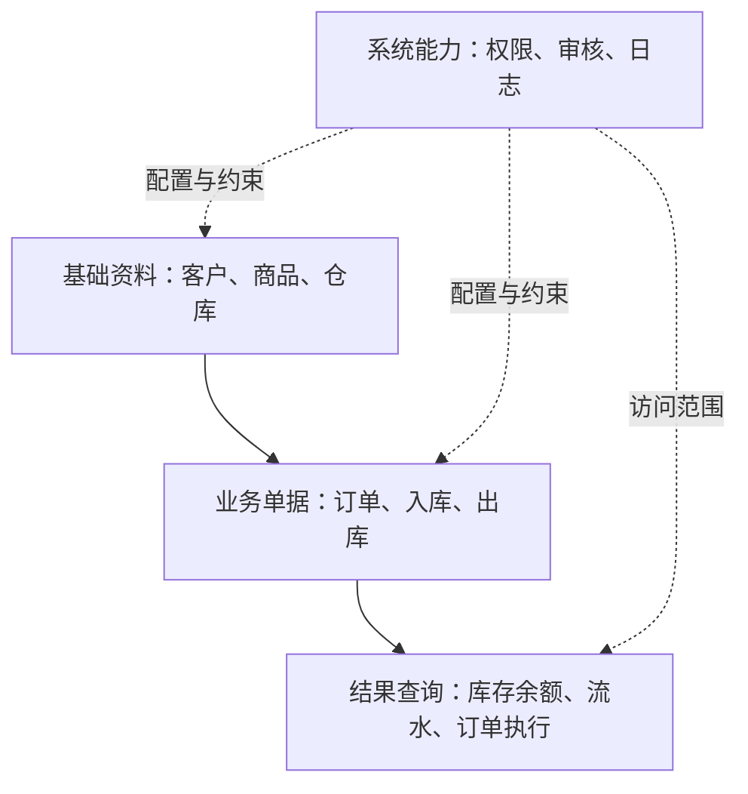

# ERPNext 与管伊佳 ERP 功能结构调研

调研日期：2026-10-17  
调研目的：理解两个产品的模块、单据和资料之间的关系，为序仓 ERP 的销售与库存产品设计提供参考。

## 1. 范围与证据

本次依据官方文档、功能清单及公开仓库整理，未登录两款产品逐页操作。因此，下面的结构是产品功能地图；ERPNext 的中文名称经过翻译和归类，实际工作区导航会随版本、权限和启用模块变化。

管伊佳的功能清单明确区分“开源版本”和“全部功能版本”。本文分别标明，生产、总账、独立盘点业务等扩展能力不能直接视为开源版标配。具体交付与插件范围应以选定版本为准。[官方版本功能清单](https://www.gyjerp.com/doc/archive/fun-list.html)、[官方插件说明](https://www.gyjerp.com/doc/)

本报告中的“设计观察”“建议结构”和“优先级”是对资料的分析；它们还没有变成我们的新增开发需求。

## 2. ERPNext：按业务领域组织的功能地图

| 业务领域 | 代表性二级功能 | 主要业务对象 |
| --- | --- | --- |
| 销售 Selling | 客户、联系人与地址、报价、销售订单、交货、销售结算、退货、价格规则、销售报表 | 客户、报价、订单、交货单 |
| 采购 Buying | 供应商、物料申请、询价、供应商报价、采购订单、采购分析 | 供应商、需求、采购承诺 |
| 库存 Stock | 商品、分类、单位、仓库、收货、交货、库存操作、盘点对账、批次与序列号、库存报表 | 商品、仓库、数量变化 |
| 财务 Accounting | 应收应付、收付款、会计分录、银行对账及财务报表 | 金额、往来与账目 |
| 制造 Manufacturing | 物料清单 BOM、工序与工作站、生产计划、工单、作业卡、物料需求计划 | 原料、产成品、生产任务 |
| 客户关系 ERPNext CRM | 线索、商机、销售阶段与漏斗分析 | 成交前的潜在需求 |
| 资产 Assets | 资产资料、折旧、维护、移动、出售与报废 | 企业自有资产 |
| 项目 Projects | 项目、任务、工时、成本与项目报告 | 项目交付 |
| 质量与支持 | 质量检查与改进、服务问题、维护及保修相关流程 | 质量问题、服务任务 |
| 通用平台能力 | 用户与权限、数据导入导出、工作流、打印和通知 | 访问范围与业务配置 |

来源：[官方功能目录](https://docs.frappe.io/erpnext/introduction)、[销售模块](https://docs.frappe.io/erpnext/selling)、[采购模块](https://docs.frappe.io/erpnext/buying)、[库存模块](https://docs.frappe.io/erpnext/stock)。Frappe HR 等独立应用不纳入本次核心产品结构。

### 2.1 销售功能的内部关系

```text
销售
├─ 资料：客户、联系人、地址
├─ 商务规则：价格表、折扣、付款条件
├─ 业务单据：报价 → 销售订单 → 交货单
├─ 结算衔接：Sales Invoice → Payment Entry
└─ 执行与分析：交付进度、部分履约、退货、销售报表
```

标准货物销售中，Sales Order 记录客户购买约定，Delivery Note 记录货物出库，后续单据记录结算与付款。ERPNext 也允许按业务采用更短的路径，例如直接使用带库存更新的 Sales Invoice。以上说明的是支持的业务路径，具体步骤由配置决定。[销售流程说明](https://docs.frappe.io/erpnext/selling)

ERPNext 支持一笔订单分次交付，未完成部分继续跟踪。因此，“订单”和“出库记录”在产品设计中需要保留独立关联，而一个“已出库”标记只适合我们当前整单出库的简化范围。[部分履约说明](https://docs.frappe.io/erpnext/partial-fulfilment-of-sales-order)

### 2.2 库存功能的内部关系

```text
库存
├─ 资料：商品、分类、单位、仓库
├─ 业务来源：采购收货、销售交货
├─ 库存操作：收料、发料、移库、生产相关领退料
├─ 数量核对：Stock Reconciliation
└─ 查询：库存余额、库存流水、库存价值
```

Stock Entry 根据不同用途处理收料、发料、仓库间转移等数量变化。单据涉及的商品、数量、来源仓库和目标仓库共同决定库存结果。[Stock Entry](https://docs.frappe.io/erpnext/stock-entry)

Stock Ledger 汇集不同业务产生的库存变动，并可从凭证编号追溯原始单据。库存余额回答“现在有多少”，库存流水回答“哪些业务导致了这些数量”。[库存流水说明](https://docs.frappe.io/erpnext/stock-ledger)、[库存核对说明](https://docs.frappe.io/erpnext/stock-reconciliation)

### 2.3 客户资料的设计观察

ERPNext 把客户、联系人和地址分别建模，并在业务中关联。对存在多位联系人、多处收货地址的客户，这种方式便于复用资料。我们当前一个客户只有一个联系人和电话，是适用于第一版的简化。[客户资料文档](https://docs.frappe.io/erpnext/customer)

## 3. 管伊佳 ERP：开源版功能地图

下表按官方“开源版本”栏目概括。二级功能仅列代表项，完整清单见原始文档。

| 一级模块 | 代表性二级功能 |
| --- | --- |
| 零售管理 | 零售出库、退货 |
| 采购管理 | 请购、采购订单、入库、退货 |
| 销售管理 | 销售订单、出库、退货 |
| 仓库管理 | 其他入库、其他出库、调拨、组装、拆卸 |
| 财务管理 | 收入、支出、收款、付款、转账、预付款 |
| 报表查询 | 库存、进销存、业务统计、出入库明细、往来对账、预警 |
| 商品管理 | 分类、商品、单位、属性 |
| 基础资料 | 客户、供应商、会员、仓库、账户、经手人 |
| 系统管理 | 用户、角色、机构、日志、配置、菜单、租户 |

来源：[管伊佳官方功能清单](https://www.gyjerp.com/doc/archive/fun-list.html)。商品与财务页面的存在也可在公开源码中核对：[商品页面目录](https://github.com/jishenghua/jshERP/tree/master/jshERP-web/src/views/material)、[财务页面目录](https://github.com/jishenghua/jshERP/tree/master/jshERP-web/src/views/financial)。

### 3.1 与销售、库存相关的结构观察

官方流程允许销售订单审核后生成出库单，也允许单独开出库单；库存查询在报表中提供。客户资料与登录用户分别由基础资料和系统管理维护。[官方功能清单](https://www.gyjerp.com/doc/archive/fun-list.html)

从产品设计角度看，这些入口分别服务于资料维护、业务执行、结果查询和访问控制。设计时应检查同一业务对象的维护入口、使用入口与追溯入口是否齐全。

### 3.2 全部功能版本的扩展范围

官方另列任务审核、独立盘点、发票跟进、总账、生产及高级报表；官网还提供对应插件说明。研究这些能力时，需要分别记录产品能力与版本可用范围。[全部功能清单](https://www.gyjerp.com/doc/archive/fun-list.html)、[插件说明](https://www.gyjerp.com/doc/)

## 4. 两款产品对销售与库存的组织方式

| 比较项 | ERPNext | 管伊佳 |
| --- | --- | --- |
| 客户入口 | 销售相关资料中关联客户、联系人与地址 | 基础资料中维护客户 |
| 商品入口 | 库存资料中维护 Item 等对象 | 独立商品管理 |
| 销售执行 | 订单关联交货及后续结算 | 销售订单关联销售出库 |
| 库存操作 | Stock Entry 等业务单据 | 仓库管理中的多种操作单据 |
| 库存查询 | 库存余额、流水等报表 | 报表查询中的库存及明细汇总 |
| 操作权限 | 平台用户、角色及数据范围配置 | 系统用户、角色及业务范围配置 |

来源：[ERPNext 官方目录](https://docs.frappe.io/erpnext/introduction)、[ERPNext 销售](https://docs.frappe.io/erpnext/selling)、[ERPNext 库存](https://docs.frappe.io/erpnext/stock)、[管伊佳功能清单](https://www.gyjerp.com/doc/archive/fun-list.html)。

下图是本次调研归纳的功能分层，可用于检查我们自己的产品结构：



## 5. 对照序仓 ERP 当前版本

当前能力依据 `app/erp/README.md` 和本轮工作区文件核对。

| 功能领域 | 当前状态 | 可考虑的后续工作 |
| --- | --- | --- |
| 客户资料 | 有列表、新增、编辑、检索和关联订单 | 地址、客户停用；多联系人按真实业务需要评估 |
| 商品资料 | 可以新增商品，库存页可查询 | 独立资料维护入口、编辑与停用、分类 |
| 销售订单 | 草稿、提交、取消、详情与历史 | 先明确是否需要审核；部分发货留待业务提出 |
| 销售出库 | 整单出库，生成独立编号和流水 | 可查询的出库单列表与详情 |
| 库存数量 | 期初初始化、余额、低库存提示 | 日常入库，明确来源与原因 |
| 库存追溯 | 有流水及订单关联 | 补充入库单详情、按业务类型和日期查询的体验 |
| 异常处理 | 缺货阻止、取消限制、重复出库保护 | 出库差错更正、退货及盘点规则 |
| 系统能力 | 本地单用户 | 多人需求明确后再设计登录、角色和权限 |

### 5.1 建议的近期功能结构

以下是设计建议，尚未作为新增功能实施：

```text
序仓 ERP
├─ 基础资料
│  ├─ 客户管理
│  └─ 商品管理
├─ 销售管理
│  ├─ 销售订单
│  ├─ 待出库
│  └─ 出库记录
└─ 库存管理
   ├─ 库存查询
   ├─ 库存流水
   └─ 入库记录
```

“待出库”可以是一个任务视图，对应底层待处理订单；它不需要成为新的业务单据类型。工作台统计也可引用这些数据。

### 5.2 建议的补齐顺序

1. 商品资料维护：与已补充的客户管理形成完整的开单前置资料。
2. 出库记录列表与详情：使每张出库单有稳定的查询和追溯入口。
3. 日常入库：先明确实际来源、操作人、数量和原因，再设计单据。采购来源应关联采购业务；其他入库需要明确业务原因。
4. 差错处理：明确已经确认出库的数量出错后如何更正，保留操作记录。
5. 报表与多人权限：依据实际使用角色和管理问题决定范围。

以上顺序是针对当前 MVP 的产品判断。采购、财务、制造的扩展继续保持单独评估。

## 6. 后续实机调研可验证的事项

- 对照选定版本登录系统，核对实际导航和权限下可见功能。
- 跑一笔订单，记录每个节点的字段、状态、按钮、关联单据和数量影响。
- 验证分批出库、退货、取消与更正是否有不同权限或单据要求。
- 在管伊佳目标开源版本中核对审核、库存变动生效时点及报表口径；本次不据功能名称推断这些实现细节。
- 在 ERPNext 目标版本中核对启用模块和工作区配置，明确核心 ERP 与其他 Frappe 应用的边界。
