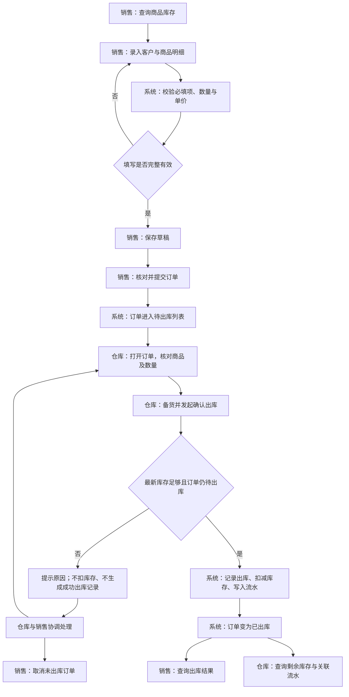
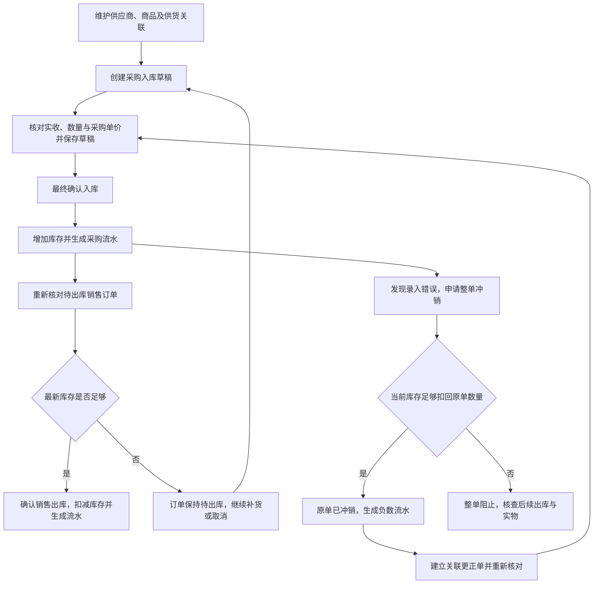

# 序仓 ERP 产品 PRD：销售、采购与库存管理

版本：V0.8  
文档状态：当前本地 MVP 功能基线；已同步采购退货及冲销互斥，当前为 11 个已实现页面，真实企业场景待调研  
创建日期：2026-10-17  
更新日期：2026-10-18

## 1. 产品目标

让经办人员维护客户、商品与供货关系，按实际收货完成采购入库，再根据销售订单完成出库；通过实物盘点核对账实差异。通过库存查询和流水，将每次数量变化追溯到业务单据、发生时间和操作人。

## 2. 已确定的范围

当前版本包含 4 个一级模块、11 个二级页面，已实现以下能力：

| 一级模块 | 二级页面 | 当前功能 |
| --- | --- | --- |
| 销售管理 | 销售订单、待出库、销售退货 | 开单、草稿编辑、提交、取消、整单出库、合格品退货入库及追溯 |
| 采购管理 | 采购入库、采购退货 | 实收登记、草稿、确认、取消、整单冲销及关联更正；部分／分次实际退回及追溯 |
| 库存管理 | 库存查询、库存盘点、库存流水 | 数量查询、旧商品期初设置、实盘录入及差异确认、按业务来源追溯流水 |
| 基础资料 | 客户管理、商品管理、供应商管理 | 资料维护、商品及供应商启停、多供应商关联、默认供货方及关联单据查询 |

所有业务列表支持对应条件筛选和重置。新增商品默认零库存，日常通过采购入库增加数量。

本期采用本地单用户、单仓库、整数数量、人民币计价、整单处理及库存不预占的范围。采购订单、审批、成本核算、付款、退款和制造后续扩展。

## 3. 待验证的业务问题

以下是需求假设，尚未经过业务调研：

- 销售接单时，难以确认商品是否有货。
- 订单传递给仓库后，销售难以及时知道是否已经发货。
- 库存数量发生变化时，难以追溯对应的业务单据。

## 4. 初步使用角色

| 角色 | 主要任务 |
| --- | --- |
| 销售人员 | 查询库存、录入订单、跟进发货 |
| 采购／资料维护人员 | 维护供应商及商品供货关联，登记采购入库草稿 |
| 仓库人员 | 核对实收并确认入库、处理销售出库、实物盘点、查询库存和流水 |

本地 MVP 由“本地用户”兼任上述分工，尚未提供员工账号、真实角色权限或主管审批。真实团队分工在后续业务调研中确定。

## 5. 当前版本验收目标

使用测试业务完整验证：

维护供应商和商品供货关联 → 建立采购入库草稿 → 确认收货并增加库存 → 提交销售订单 → 确认出库并扣减库存 → 从流水追溯采购和销售单据。

验收还包括：缺货后补货再出库；入库录错后整单冲销和关联更正；盘盈、盘亏与零差异记录；盘点期间进出库后的重新核对；重复与并发操作；失败整单回滚；默认供货方带入、停用保护及临时采购；修改资料后历史单据保持原值；刷新保留和手机操作。

## 6. 当前最关键的待确认项

服务哪类企业，以及它们如何接单、备货和发货。

以下业务背景仅作为待选择方向，尚未确定：

| 方向 | 场景说明 |
| --- | --- |
| 贸易／批发公司 | 客户下单，仓库备货发货，销售和库存联系直接。作为起步场景的建议，待确认。 |
| 零售门店 | 顾客现场购买，重点是快速开单和即时出库。 |
| 制造企业 | 销售可能涉及现货和待生产商品，需要先明确与生产环节的边界。 |

办公用品用于示例工作区。单仓库、整单一次出库、不预占库存已作为当前 MVP 的实现与验收边界；其对真实企业的适用性仍需调研。

## 7. 用户流程设计

### 7.1 流程设计前提

以下为已确定的本期操作规则，真实企业业务适配另行验证：

- 以有现货的销售业务为设计场景，客户先下单，仓库再发货。
- 暂按一个仓库设计，每张订单一次性全部出库，不支持部分出库。
- 销售与仓库按两种角色描述；即使同一人兼任，两步业务操作仍然区分。
- 商品和客户已建立，新商品默认零库存。旧待初始化商品通过期初录入或零库存确认启用；日常补货采用采购入库。
- 第一版暂不设计主管审批和库存预占。下单时看到的库存仅供参考，以确认出库时的最新库存为准。
- 第一版采用“保存草稿 → 提交订单 → 确认出库”的操作方式；确认出库代表货物已核对并完成交接，不代表客户已签收。

### 7.2 销售、采购和库存的关系

销售管理记录客户需求及出库结果；采购管理记录本次供应商交付的货物；库存管理汇总库存数量并追溯每次变化。商品与供应商的供货关联在基础资料中维护。

保存销售、采购或盘点草稿、提交销售订单、取消未生效单据均保持库存不变。确认采购入库成功后增加库存；确认销售出库成功后扣减库存；冲销入库成功后扣回原入库数量；确认盘点后按差异生成盘盈或盘亏；销售退货验收入库后按本次合格实收数量增加库存；采购退货交接出库后按本次数量扣减库存。每次生效操作同时更新单据、数量及对应流水，失败则整单保持原值。

### 7.3 销售管理用户流程

#### 流程 S1：查询库存并创建订单

**使用者：** 销售人员。  
**触发：** 收到客户购买需求。  
**目标：** 将客户需求保存成可继续处理的订单。

| 步骤 | 用户操作 | 系统反馈与结果 |
| --- | --- | --- |
| 1 | 进入库存列表，按商品编码或名称搜索 | 展示商品、单位和当前库存；标明此数量尚未为订单预留 |
| 2 | 进入销售订单列表，点击新建 | 打开开单页 |
| 3 | 选择客户、填写期望发货日期，添加商品、数量和销售单价，可填写备注 | 展示每行金额与订单总金额；本阶段仅表示销售金额，不表示已收款 |
| 4 | 点击保存草稿 | 校验必填项、数量大于零、单价非负；不通过则保留输入并定位问题，通过则生成订单编号，状态为草稿 |
| 5 | 核对客户与商品明细，点击提交订单 | 再次校验；成功后进入待出库状态，仓库可以查询到该订单；库存不变 |

**分支：**

- 客户或商品不存在：先在基础资料中新增，再回到销售订单开单。采购入库表单另有快捷新增供应商、商品的入口，可保留本单已填内容；销售表单内的同类快捷维护后续扩展。
- 库存不足：提示不足的商品与数量。由于暂不做库存预占，当前允许记录并提交待出库订单，由销售与仓库协调；确认出库时必须有足够库存。
- 草稿需要修改：直接编辑后重新保存。

#### 流程 S2：跟进订单与取消未出库订单

1. 销售进入订单列表，按订单编号、客户、日期或状态查找订单。
2. 打开订单详情，查看商品明细、状态和操作记录。
3. 待出库时，可以跟进仓库处理，也可以填写原因后取消订单。
4. 已出库时，查看出库时间、操作人和关联出库记录。

**当前规则：** 待出库订单暂不允许直接修改客户、商品、数量或单价。需要变更时取消原单，再建立新单，避免仓库按旧信息备货。已出库订单不可取消或直接修改；合格品退货按第 15.1 节处理，出库差错更正另行定义。

### 7.4 库存管理用户流程

#### 流程 I0：建立期初库存（启用前置流程）

1. 进入“库存管理 → 库存查询 → 期初设置”，选择旧的待初始化商品。商品页提供跳转该入口的快捷操作。
2. 选择“录入已有期初库存”，填写核对后的数量；或明确选择“确认没有历史库存，按零启用”。
3. 确认后记录期初数量、流水、操作人和时间，关闭该商品的期初入口。
4. 之后通过采购入库、销售出库等日常业务改变数量。新建商品直接零库存就绪，可选择关联供应商并进入采购入库。

**边界：** 期初设置用于承接历史库存；重复初始化和已有库存流水后补录均会被阻止。期初单据差错更正另行设计；实际账实差异采用第 14 节的库存盘点流程。日常进货采用第 12 节的采购入库流程。

#### 流程 I1：处理销售出库

**使用者：** 仓库人员。  
**触发：** 销售提交订单后，出现待出库任务。  
**目标：** 按订单完成出库，并留下可追溯的数量变化记录。

| 步骤 | 用户操作 | 系统反馈与结果 |
| --- | --- | --- |
| 1 | 进入待出库列表，选择订单 | 展示客户、期望发货日期、商品、应出库数量和最新库存 |
| 2 | 对照订单核对实物并备货 | 此时不扣减库存 |
| 3 | 核对无误后点击确认出库 | 展示本次将出库的商品及数量，提示确认后将扣减库存 |
| 4 | 完成货物交接时，最终确认出库 | 重新检查订单仍为待出库、所有商品库存均足够 |
| 5 | 查看处理结果 | 成功：生成关联出库记录、扣减库存、生成流水，订单变为已出库；失败：说明原因，不保留部分成功结果 |

**异常分支：**

- 任一商品库存不足：整单不出库，展示商品、当前库存和缺少数量，订单保持待出库，由销售与仓库协调补货或取消；可通过采购入库补货，确认入库后再重新核对并出库。
- 订单已取消：阻止出库，提示刷新订单信息；已备货的实物由仓库停止交接并归回原位。
- 订单已出库或重复点击：展示原有出库结果，不再次扣库存、不重复生成出库记录。
- 操作结果不明确或网络中断：提示先重新查询订单状态及出库记录，再决定是否重试；不可仅因页面报错就认定未出库。
- 实物与系统库存不一致：暂停出库并反馈差异，通过库存盘点重新清点及确认差异；不能直接修改库存列表中的数量。

#### 流程 I2：查询库存并追溯流水

1. 用户进入库存列表，通过商品名称或编码搜索。
2. 查看商品单位及当前库存；当前库存表示账面在库数量，暂不承诺已为某张订单留货。
3. 点击“查看流水”，携带商品筛选进入库存流水，按日期和业务类型继续筛选。
4. 每条流水展示发生时间、业务类型、变动数量、变动后数量、关联单号和操作人。
5. 点击销售出库关联单号查看销售订单；点击采购入库或冲销单号查看原入库单及相关记录。期初流水展示初始化凭证编号、数量、时间和操作人。

当前流水来源包含期初库存、销售出库、采购入库、入库冲销、盘盈入库、盘亏出库、销售退货入库和采购退货出库，采购及盘点流水可追溯原单。零差异仅保留盘点结果，不生成数量变动流水。

### 7.5 订单状态与库存影响

| 当前状态 | 允许的核心操作 | 目标状态 | 库存影响 |
| --- | --- | --- | --- |
| 草稿 | 编辑并保存 | 草稿 | 无 |
| 草稿 | 提交订单 | 待出库 | 无，不预占 |
| 草稿 | 填写原因并取消 | 已取消 | 无 |
| 待出库 | 确认整单出库成功 | 已出库 | 按订单商品数量扣减，并记录流水 |
| 待出库 | 出库校验失败 | 待出库 | 无 |
| 待出库 | 填写原因并取消 | 已取消 | 无 |
| 已出库 | 查询订单、出库记录 | 已出库 | 查询不改变库存 |
| 已取消 | 查询订单及取消原因 | 已取消 | 无 |

取消和出库可能在同一时间发生。系统以成功完成的操作为准：取消成功则不能出库，出库成功则不能取消，不能出现订单已取消但库存已扣减的结果。

### 7.6 用于评审流程的例子

以下数量仅用于检验流程，不代表业务规模要求：

| 场景 | 操作 | 预期结果 |
| --- | --- | --- |
| 正常销售 | 期初有 100 把椅子，创建并提交 30 把的订单 | 库存仍为 100，订单待出库 |
| 正常出库 | 对该订单确认出库 | 库存变为 70，订单已出库，存在一条关联的销售出库流水 |
| 重复确认 | 再次对同一订单确认出库 | 库存仍为 70，不增加第二条出库记录 |
| 库存不足 | 当前有 70 把，提交 80 把的订单并尝试出库 | 提交后库存不变；出库被阻止，提示缺少 10 把，订单仍待出库 |
| 取消订单 | 取消一笔未出库的订单 | 订单已取消，库存不变，仓库不能继续出库 |
| 多笔订单共用库存 | 库存为 70，两笔订单分别购买 50 把和 40 把 | 不预占；第一笔出库成功后库存为 20，另一笔出库时因不足被阻止 |
| 多商品订单 | 订单有两种商品，其中一种库存不足 | 整单不出库，两种商品均不扣库存 |

### 7.7 已确定规则与后续调研

已确定：单仓库、一次性整单出库；库存不足时可保存及提交销售订单，确认出库时必须充足；无库存预占；直接创建采购入库单；本地用户兼任业务分工。

待调研或扩展：目标企业类型、实际角色及审批、多仓库、分批履约、期初差错、出库更正、坏品退回、库存成本及财务处理。

### 7.8 采购补货接续销售出库

例如：原库存 20 把椅子，销售订单需 50 把，出库时提示不足；采购实收入库 50 把后，库存为 70；再确认销售出库 50 把，剩余 20。采购和销售分别生成来源明确的流水。

## 8. MVP 实现范围

当前按第 7 节的业务流程实现本地 MVP，以便实际操作评审。单仓库、整单出库、不预占库存作为本轮实现边界，不代表已完成真实企业业务调研。

- 入口：`/erp`，产品暂名“序仓 ERP”。
- 采用办公用品示例工作区，支持新增客户、商品、供应商和采购入库；旧商品保留一次性期初设置。
- 实现订单新建、草稿编辑、提交、取消、详情及操作记录。
- 实现待出库列表、整单出库、缺货阻止、重复出库保护。
- 实现销售退货草稿、验收入库、部分／分次退回、累计可退量、修订及重复保护、原单摘要与流水追溯。
- 实现库存查询、库存状态筛选、流水及关联单据追溯。
- 实现采购入库新建、草稿编辑、确认、取消、整单冲销和关联更正；支持表单内快捷建立供应商及商品。
- 实现采购退货草稿、部分分次交接出库、来源额度及库存校验、冲销互斥、供应商反查、流水追溯和手机操作。
- 实现商品多供应商关联、默认供货方、关联筛选、供应商反查供货商品、采购分组推荐及临时采购记录。
- 供应商管理提供新增、编辑、启停、供货商品数量及关联入库单查询。
- 客户资料管理：提供客户列表，支持按名称、编号、联系人或电话搜索；新增和编辑名称、联系人、电话；从客户查看关联订单并清除筛选。联系人和电话选填，已有客户资料保持兼容。编辑资料不改变客户编号、订单关联或库存。
- 数据保存在当前浏览器，刷新后保留；提供 JSON 备份导出。
- 当前没有账号认证、跨设备协作和服务端数据库，仅供本地单用户操作与产品流程验证。

完整使用说明与当前限制见 [ERP MVP 使用说明](app/erp/README.md)，实现分工见 [MVP 实现说明](app/erp/IMPLEMENTATION.md)。

## 9. 一级模块与二级功能

本轮按已有业务能力组织两级导航：

| 一级模块 | 二级功能 | 页面职责 |
| --- | --- | --- |
| 销售管理 | 销售订单 | 创建、提交、取消及跟进订单 |
| 销售管理 | 待出库 | 查询待处理订单并确认整单出库 |
| 销售管理 | 销售退货 | 按原出库订单登记部分／分次退货、验收合格后入库 |
| 采购管理 | 采购入库 | 实收登记、确认入库、冲销和关联更正 |
| 采购管理 | 采购退货 | 按原入库部分／分次退回，核对交接后整单出库 |
| 库存管理 | 库存查询 | 查询商品库存数量、状态及期初录入 |
| 库存管理 | 库存盘点 | 清点实物、保存草稿、复核差异并确认调整 |
| 库存管理 | 库存流水 | 查询库存变化及业务来源 |
| 基础资料 | 客户管理 | 查询、新增、编辑客户资料及查看关联订单 |
| 基础资料 | 商品管理 | 商品维护及启停、多供应商关联、默认供货方，默认零库存 |
| 基础资料 | 供应商管理 | 维护及启停供货方、反查供货商品和入库单 |

一级模块支持折叠，二级功能为具体业务页面。顶部面包屑同步展示一级模块及二级功能。跨模块跳转自动展开目标模块并标记目标页面。从客户查看订单、从商品查看库存、从供应商查看供货商品或入库单，以及从入库详情查看流水时，均携带对应条件。

商品管理提供资料维护，期初入口集中到库存查询，日常补货使用采购入库。供应商管理归入基础资料。财务、制造等模块在业务范围确定后加入。

## 10. 中文界面字号

正文、表格、导航、按钮与录入表单标签采用 14px；说明、计数与筛选辅助标签最低 12px，移动端不进一步缩小。区块标题采用 16px，弹窗标题 18px，桌面页面标题 28px。手机端表单输入文字采用 16px。放大文字时同步调整行高、控件高度、换行与表格滚动，保持内容和操作完整。

以上为本项目可读性基准，参考 [Ant Design 字体规范](https://ant.design/docs/spec/font-cn/)。

## 11. 商品资料维护与列表筛选

### 11.1 商品维护

在“基础资料 → 商品管理”内新增编辑资料及启用／停用，不另建重复菜单。

- 可修改名称及参考售价；新订单选择商品时使用最新参考售价，已保存订单的单价及金额不自动改变。
- 商品已有销售订单、采购入库草稿或库存流水后，编码及单位锁定。未使用商品允许修改，编码仍须唯一。
- 历史订单保留开单时的商品名称、编码和单位。旧记录在首次修改对应商品资料前补齐快照，使用修改前的资料。
- 未设置启用状态的既有商品按启用处理，兼容原有浏览器数据。
- 停用需确认，库存及历史数据保留；新订单不能选择停用商品，已有草稿含停用商品时需移除、替换或重新启用后保存及提交。
- 已提交的待出库订单仍可履行，出库时继续校验库存；重新启用后恢复新开单。
- 商品编辑不调整库存数量，库存变化仍通过期初及出入库业务处理。

### 11.2 业务列表筛选

本期“每个表单有筛选器”按业务列表页执行，新增／编辑弹窗仍用于录入资料。

| 列表 | 筛选条件 |
| --- | --- |
| 销售订单 | 状态页签、客户、商品、期望发货日期起止、关键词 |
| 待出库 | 客户、商品、期望发货日期起止、关键词；仅展示待出库订单 |
| 销售退货 | 状态、客户、商品、创建日期、关键词及原订单来源 |
| 库存盘点 | 状态、商品、创建日期、单号／商品／备注关键词 |
| 库存查询 | 库存状态、销售单位、关键词 |
| 库存流水 | 商品、流水类型、发生日期起止、关键词 |
| 客户管理 | 有订单／未开单／有待出库订单，联系方式齐全／待补充，关键词 |
| 商品管理 | 启用状态、期初状态（已就绪／待设置）、销售单位、关联供应商／尚未关联、关键词 |
| 采购入库 | 状态、供应商、商品、收货日期、单号／送货单号关键词 |
| 采购退货 | 状态、供应商、商品、创建日期、关键词及原入库单来源 |
| 供应商管理 | 启用状态、入库单关联、关键词 |

筛选条件即时生效，多条件取交集；每页提供“重置筛选”，清除关键词、日期、选择项及订单状态页签。跨模块跳转可携带客户、商品、供应商或入库单条件，普通切页重置条件。日期含起止当天，流水日期按本地日期计算；开始晚于结束时提示错误并展示空结果。无结果显示空态，不修改业务数据。

手机端筛选采用双列布局，输入字号 16px，保持正文 14px、辅助信息最低 12px。

## 12. 采购入库与日常补货（已实现）

日常补货、供应商管理、入库确认及纠错详见 [采购入库功能方案](PRD-ERP采购入库方案.md)。当前版本直接创建采购入库单，一单对应一家实际供应商、一批实收商品和主仓库。

必填信息包括供应商、收货日期、商品、实收数量和采购单价；送货单号及备注选填。数量为正整数，金额最多两位小数；零元采购需填写原因。采购单价独立录入，商品参考售价保持原值。

| 状态 | 允许操作 | 库存影响 |
| --- | --- | --- |
| 草稿 | 编辑、保存、取消、确认入库 | 保存及取消无影响；确认成功才增加 |
| 已入库 | 查看、按纠错规则整单冲销 | 原单只读；冲销成功扣回原实收数量 |
| 已取消 | 查看 | 无 |
| 已冲销 | 查看、建立关联更正单 | 查询及建立草稿无影响；更正单确认后重新增加 |

重复确认或重复冲销同一单据只生效一次。任一商品超限、停用、未就绪或存储失败时，入库整单阻止；冲销任一商品余额不足时也整单阻止，保留原单和库存。

采购退货见第 15.2 节，已包含冲销互斥保护：原入库单存在已出库采购退货后，整单冲销被阻止；只有退货草稿时仍可冲销，旧退货草稿随后不能确认但可取消。

同一供应商、同一送货单号已有入库记录时提示核对，分批收货需明确确认。收货日期可填当天或过去日期；库存按最终确认时点生效，流水分别保留业务日期和实际记账时间。

已入库单保存确认时的供应商与商品资料、单位及采购单价。冲销保留原正数流水并追加负数流水；原单与更正单可相互追溯。供货关系规则见第 13 节，旧工作区升级时保留数据。

## 13. 商品与供应商关联（已实现）

### 13.1 主数据关系

一个商品可关联多家供应商，一家供应商可供应多个商品。商品可指定一个关联内的默认供应商，也可保持未关联、未设置默认。旧商品未设置关联时继续可用，已有采购记录保留原有业务含义。

商品新增和编辑表单提供关联供应商多选、供应商搜索及默认供应商设置。取消关联默认供货方时，同时清空默认设置。商品列表展示关联名称和默认供货方，支持按关联供应商及“尚未关联”筛选。

供应商列表展示供货商品数量，提供“查看供货商品”入口，跳转商品管理并携带供应商筛选。供货商品数量只统计明确维护的资料关联；实际入库记录通过“查看入库单”单独查询。

### 13.2 采购建议与本单供货

采购入库在选定供应商后，商品下拉列表先展示其关联商品，再展示可临时采购的其他商品。若先选商品且本单尚未选供应商，则带入该商品有效的默认供应商。已有入库草稿保持原供应商；已选供应商后继续添加商品，也保持本单供货方。

未关联商品允许临时采购，草稿及确认界面提示核对供货方与本次单价。确认入库时记录临时采购商品及操作历史，供货主数据保持原值。后续关联、取消关联或修改默认供应商，都保持已有入库单的供应商、商品资料、采购价格、数量和库存流水原值。

### 13.3 停用与边界

已停用供应商的既有关联及默认配置保留，界面标明停用，新单不自动选用。用户可更换默认供应商或重新启用；停用供应商不能新增关联或新设为默认。旧的停用默认配置可以原样保留，取消关联时同步清空。

本期按商品汇总库存，不将供货关联视为剩余库存的供应商归属。批次、来源库存分层和供应商报价后续设计。

## 14. 库存盘点

### 14.1 用户流程

仓库人员进入“库存管理 → 库存盘点”，新建盘点单并选择本次清点的商品。系统记录每种商品的账面数量和对应库存流水基准；用户实际清点后填写实盘数量，有差异时填写原因。

新建盘点单 → 选择商品并清点实物 → 填写实盘数量及差异原因 → 保存草稿 → 核对差异 → 勾选确认已复核 → 确认差异并更新库存。

实盘数量初始为空，实物为零时须明确填写 0。每单 1 至 100 种商品，同商品不能重复；实盘数量为 0 至 1,000,000 的整数。差异原因每行最多 300 字，备注最多 1000 字。已停用但已经初始化的商品仍可盘点；旧待初始化商品先完成期初设置。

### 14.2 单据状态与库存影响

| 当前状态 | 操作 | 结果与库存影响 |
| --- | --- | --- |
| 草稿 | 编辑并保存 | 保留实盘结果，库存不变 |
| 草稿 | 填写原因并取消 | 已取消，原单和历史保留，库存不变 |
| 草稿 | 核对并确认 | 已确认，整单按差异调整库存并生成流水 |
| 草稿 | 最新库存业务与清点基准不同 | 整单阻止，提示编辑草稿并重新核对实物 |
| 已确认 | 查询详情和本单流水 | 只读；重复确认不再次调整库存 |
| 已取消 | 查询详情及原因 | 只读，不能继续确认 |

差异 = 实盘数量 − 账面数量。例如账面 100、实盘 98，确认后生成一条盘亏 2 的流水，库存为 98；账面 60、实盘 63，生成盘盈 3 的流水。零差异商品保留单据结果，不生成无数量变化的库存流水。不同单位不汇总为一个差异数量。

### 14.3 盘点期间进出库与并发保护

本期不冻结仓库业务。保存和确认时都比较每个商品的账面数量与最近一条流水记录。清点后发生采购入库、销售出库、冲销或其他盘点调整，即使进出数量抵消、账面数恢复原值，也必须重新核对；其他未盘点商品的业务不阻止本单。

用户编辑草稿，逐行点击“重新核对”，系统读取最新库存并清空该行实盘数量和原因，用户重新清点及填写后再保存。未重新清点不能直接沿用旧结果覆盖新库存。窗口重新激活和同浏览器标签消息会刷新页面，最终以确认事务中的最新数据为准。

草稿编辑、确认和取消校验修订号，旧页面不能覆盖已经更新的草稿。库存、单据及流水在同一事务中整单写入，任一校验或存储失败则全部保留原值。已确认单据不直接编辑或冲销，后续发现实物差异需重新盘点。

### 14.4 查询和追溯

列表提供单号／商品／备注搜索，以及盘点状态、商品、创建日期范围筛选和重置。展示商品种数、差异商品种数、状态和是否须重新核对。详情保留账面、实盘、差异、原因、商品资料快照及操作记录。

“查看本单流水”进入带来源筛选的库存流水，盘盈和盘亏支持分别筛选，流水单号可返回盘点详情。零差异单据的来源流水为空，盘点单继续保留。未保存的修改在关闭、切页或刷新前提示确认；手机端商品按逐项表单排列。

本期盘点只处理数量，库存按实际确认时间生效，不进行历史库存回算、成本估值、财务损益或审批。

## 15. 验收清单与交付边界

| 验收项 | 预期结果 |
| --- | --- |
| 供货关联维护 | 一商品多供应商，默认必须属于已选关联；移除默认关联会清空默认值 |
| 供货关联与历史独立 | 修改或取消关联后，历史供应商、数量、采购单价、库存和流水保持原值 |
| 默认带入 | 供应商为空时选商品可带入有效默认值；已有草稿和已选供应商保持本单值 |
| 停用供货方 | 既有关联保留并标注，新单不自动选用；禁止新增停用关联及新设停用默认 |
| 临时采购 | 未关联商品可入库，提示核对并记录临时采购，不自动改绑 |
| 草稿与确认 | 销售及采购草稿无库存影响；各最终操作按业务规则整单生效 |
| 重复与并发 | 同单重试不重复入账，不同单据按最新余额处理，失败整单回滚 |
| 冲销与更正 | 冲销扣回原单并保留历史；余额不足时整单阻止；更正单与来源可互查 |
| 期初与零库存 | 旧待初始化商品需明确选择，新商品直接零库存；启用后关闭期初补录 |
| 盘点与差异 | 草稿不改库存；盘盈盘亏整单生效，零差异保留结果；库存业务变化后必须重新清点 |
| 盘点并发与历史 | 重复确认只生效一次；旧修订号阻止覆盖；已确认结果只读，商品改名不改历史快照 |
| 销售退货 | 草稿不改库存；累计不超退；合格实收才入库；原单数量金额保留，摘要及来源可追溯 |
| 采购退货与冲销 | 来源额度和当前库存双重校验；缺货草稿不预占；实际退货后阻止整单冲销，反向竞争只生效一种结果 |
| 退货并发与回滚 | 同单幂等，不同单据按最新额度校验；修订、取消互斥、疑似重复提醒及失败整单回滚 |
| 十一页筛选与追溯 | 条件取交集、重置恢复，跨模块携带条件；流水可反查销售／采购／盘点单据 |
| 数据与手机操作 | 刷新后资料和单据保留；窄屏筛选、供货关联和采购表单可操作 |

规则与验收脚本见 [实现说明](app/erp/IMPLEMENTATION.md)，操作步骤见 [使用说明](app/erp/README.md)。

当前交付保留以下边界：本地浏览器存储、无员工权限与跨设备协作；采购金额只登记，不自动形成成本、应付或付款；商品库存统一汇总，暂不区分剩余货物的供应商或批次来源；采购订单、退款、坏品库存及期初／出库单据差错更正另行设计。

### 15.1 销售退货（已实现）

按 [销售退货功能方案](PRD-ERP销售退货方案.md) 实现：从原已出库订单创建退货草稿 → 选择原单商品、数量及逐行原因 → 收货后填写实收日期并修正为本次合格实收数量 → 明确勾选验收并整单确认入库 → 查询原订单及本单流水。

草稿可空实收日期，不改库存、不预占可退量。剩余可退量按原订单逐商品计算为原出库量减去所有已入库退货；保存及确认读取最新数据。每单 1 至 100 行，正整数数量且不超过可退量和系统上限，原因每行 1 至 300 字，备注最多 1000 字。确认须有有效实收日期，允许当天及过去日期；按实际确认时间记账。

单据状态为草稿、已入库、已取消。草稿可编辑及填写原因取消；已入库只读，同单重试不重复增加库存。修订号阻止旧页面覆盖或误确认新明细；不同单据同原单、日期及商品数量组合触发人工重复核对，仍执行全部数量校验。单据、库存与流水在同一事务写入，失败整单回滚。

允许停用的原单商品退回且保持停用。原订单保留已出库状态、数量、单价及金额，另显示未退货／部分退货／全部退货摘要。退货保留客户与商品快照；流水新增销售退货入库类型及退货来源，相关旧盘点须重新核对。销售退货提供组合筛选、原订单条件、未保存保护及手机逐项录入。

本期只接收合格实物。平台自动同步、退款、坏品库存、换货、审批及退货入库冲销更正后续扩展；人工核对不能自动识别所有重复收货。

### 15.2 采购退货（已实现）

按 [采购退货功能方案](PRD-ERP采购退货方案.md) 实现本地 MVP，纳入第 2、9 节当前已实现能力和现有 11 页导航。

在“采购管理”提供采购退货页面，流程为：关联已确认且未冲销的原采购入库单 → 按原单商品登记拟退数量及原因 → 保存草稿 → 仓库核对实物和本次交接数量 → 填写实际退货日期 → 明确确认交接并整单退货出库 → 扣减库存并追溯流水。

**数量规则：** 来源剩余可退额度 = 原单实收数量 − 累计已出库采购退货数量。保存草稿不占额度和库存，可暂时缺货；确认时本次数量既不能超过最新来源额度，也不能超过最新账面库存。同源额度竞争、不同原单共用库存均在同一事务校验，任一失败整单回滚。原单关联只提供业务来源，统一库存无法证明剩余实物属于某个供应商或批次，须人工核对。

**状态与来源：** 草稿可编辑及填写原因取消，已出库和已取消只读；每单 1 至 100 行正整数数量，逐行原因必填。原单及实际供应商只读固定，采用原单快照。供应商或商品停用不阻止历史采购退回，但保留停用状态。原入库保留已入库状态、实收、采购价格、金额和原正数流水，另显示退货摘要及关联单据。

**冲销互斥：** 同一原单一旦存在已出库采购退货，整单冲销必须被阻止。只有退货草稿时仍可冲销，成功后旧退货草稿失去有效来源，确认被阻止但可取消。退货与冲销并发以先成功事务为准，界面及业务命令均执行保护；原单已冲销时只能以实际已确认的更正入库单另行作为新来源。

**确认与追溯：** 草稿实际退货日期可空，最终确认必填且不晚于当天、不早于原业务收货日期；库存按确认时间记账。显式确认本次实物已核对、供应商同意且货物已交接出库，不表示供应商已签收或退款。同单重试只生效一次，修订号防止旧页面操作；不同单据同来源／日期／商品数量组合触发人工重复核对。流水新增采购退货出库负数类型及退货来源，参与现有盘点基准，净零变化仍需复核。

本期支持部分、分次退货及手机逐项录入，不新增退款、应付调整、税额、成本、审批、换货、质量库存、平台同步或退货出库更正；尚未入库的拒收商品不扣账面库存。按方案中的 22 项场景组织业务和真实浏览器验收，回归原采购冲销、更正、销售及盘点；验证入口见使用说明与实现说明。

## 16. 文档变更

| 版本 | 日期 | 变更 |
| --- | --- | --- |
| V0.4 | 2026-10-17 | 统一销售、采购与库存范围；补齐供货关联、默认供应商、停用、临时采购、筛选及验收；清理早期范围和待确认表述 |
| V0.5 | 2026-10-17 | 增加库存盘点：草稿、实盘及原因、确认调整、盘盈盘亏流水、库存变化复核、修订号及重复保护；同步九页结构与验收 |
| V0.6 | 2026-10-18 | 增加销售退货：原单关联、草稿、合格实收、部分及分次、累计可退、修订及重复保护、原单摘要、流水与盘点联动、十页导航及手机操作 |
| V0.7 | 2026-10-18 | 增加采购退货待评审方案及第 15.2 节：部分分次、来源额度与库存校验、冲销互斥、交接确认、追溯及验收；该版已实现能力仍为十页，只更新文档 |
| V0.8 | 2026-10-18 | 实现采购退货、交接出库、来源额度及库存双重校验、冲销互斥、供应商追溯、旧数据兼容及十一页导航，补齐验证和操作说明 |
