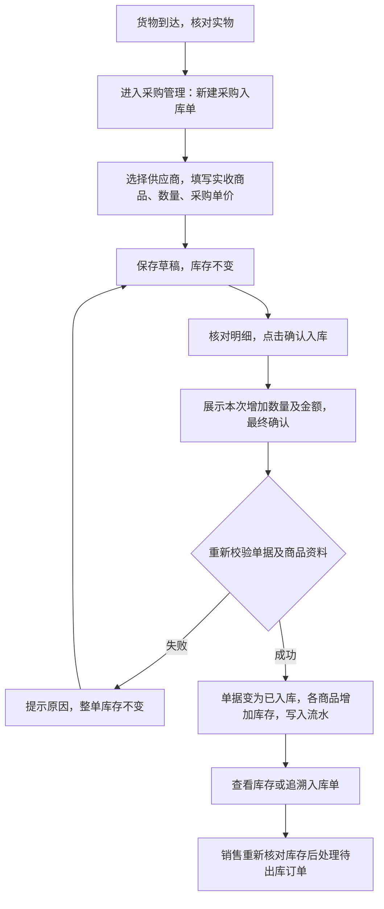

# 序仓 ERP：采购入库功能方案

版本：V1.2  
日期：2026-10-17  
状态：用户已确认，已实现本地 MVP  
关联：[ERP 产品 PRD](PRD-ERP产品.md)

## 1. 方案概要

补充日常进货后的采购入库流程：建立供应商资料，创建采购入库草稿，核对实收商品后确认入库。系统在确认成功时增加库存并生成可追溯的流水。

本期采用“直接创建采购入库单”的路径，采购申请、采购订单、付款及财务核算后续扩展。以下范围经用户确认，已在现有 ERP 中实现。

## 2. 相关人员与操作分工

| 分工 | 任务 | 当前约束 |
| --- | --- | --- |
| 产品负责人 | 评审范围、规则及验收结果 | 具体人员以实际项目安排为准 |
| 采购／资料维护人员 | 维护供应商，录入商品、价格及收货信息 | 允许由仓库人员兼任 |
| 仓库人员 | 核对实物、实收数量，确认入库 | 确认代表货物已核对并收妥 |
| 实施与开发人员 | 按评审结果实现并验证 | 本期沿用本地单用户版本 |

上述分工用于描述业务职责。当前没有员工账号和权限系统，由“本地用户”操作；本期不增加多人审批。

## 3. 背景与依据

本次扩展前，版本已有销售订单、销售出库、库存查询、库存流水、客户及商品管理，日常补货尚未实现。本次增加采购入库及其关联流程。

期初库存用于系统启用时承接已有库存；采购入库用于登记供应商本次实际交付的货物。两者分别保留业务来源，库存数量统一由单据计算。

官方资料支持直接建立采购收货／入库单的业务路径：

- [ERPNext：采购收货](https://docs.frappe.io/erpnext/purchase-receipt)：通常关联采购订单，配置允许时可以直接创建；提交后生成库存流水。
- [管伊佳：开源版本功能清单](https://www.gyjerp.com/doc/archive/fun-list.html)：采购入库单可由采购订单转换，也可单独创建。
- [ERPNext：期初库存](https://docs.frappe.io/erpnext/opening-stock)：提供正式的期初库存登记方式。

以下流程和界面结构为当前序仓 MVP 的功能基线，真实企业现场调研后继续验证适用性。

## 4. 目标与验收结果

目标：用户能够登记本次实收货物，确认后看到库存增加，并从库存流水追溯到对应入库单及供应商。

本期交付验收时，应满足：

1. 草稿保存、编辑和取消均保持库存不变。
2. 一张入库单确认一次，各商品库存按实收数量增加一次，每行生成一条来源明确的流水。
3. 重复点击、刷新后重试及同浏览器多标签操作，不重复增加库存。
4. 任一商品校验失败或保存失败，整单保持原状态，各商品库存和流水均不出现部分成功。
5. 采购入库、供应商列表均有筛选与重置；桌面和手机可完成录入、确认及查询。
6. 通过“缺货订单 → 采购入库 → 库存充足 → 销售出库”的完整验收用例。

以上是交付验收条件，实际效率提升与用户使用情况待后续试用记录。

## 5. 适用场景与范围

面向单仓库、以商品进货和销售为主的小型业务，先处理已经到货的一批商品。沿用数量为整数、人民币计价和本地浏览器保存的现有边界。

| 本期纳入 | 后续扩展 |
| --- | --- |
| 最小供应商资料维护 | 供应商账期、对账和绩效 |
| 直接创建采购入库单 | 采购申请、采购订单及审批 |
| 一张单记录一次实际收货 | 根据采购订单跟踪分批到货及未到数量 |
| 草稿、确认、取消、入库纠错冲销，以及关联采购退货 | 退货物流、供应商签收和退款 |
| 采购金额登记及库存数量变化 | 税额、运费分摊、成本估值、应付和付款 |
| 单仓库，整单确认 | 多仓库、批次、序列号及质检流程 |

分批到货时，每批按本批实际收到的数量建立一张入库单。因本期没有采购订单，系统暂不计算供应商还欠交多少货。

## 6. 用户价值

- 仓库人员按实际收到的数量入账，库存查询能反映这次收货结果。
- 销售人员在补货后重新确认可出库数量，继续处理原有待出库订单。
- 经办人员可根据单号追查供应商、商品、数量、采购价格、收货日期及操作记录。
- 资料填错时，草稿可修改，已入库单通过留有记录的冲销处理。

## 7. 功能与用户流程

### 7.1 一级模块与二级功能

当前按业务归属增加采购管理及相关页面：

```text
销售管理
├─ 销售订单
└─ 待出库
采购管理（新增）
└─ 采购入库（新增）
库存管理
├─ 库存查询
└─ 库存流水
基础资料
├─ 客户管理
├─ 商品管理
└─ 供应商管理（新增）
```

“采购入库”负责记录本次收货，“库存查询”展示各业务汇总后的数量，“库存流水”提供变动追溯。库存数量列保持只读。

### 7.2 最小供应商管理

| 字段 | 要求 |
| --- | --- |
| 供应商编号 | 系统生成且保持不变 |
| 供应商名称 | 必填，去除首尾空格后去重 |
| 联系人、联系电话 | 选填，沿用客户资料的长度限制 |
| 启用状态 | 默认启用，可停用或重新启用 |

支持新增、搜索、编辑、启用／停用和查看关联入库单。有业务记录后保留资料，通过停用结束后续使用。

新单只选择已启用供应商。供应商停用后，已有草稿需更换供应商或重新启用后确认；已入库单照常查询和按规则冲销。入库确认时保存供应商名称快照，后续改名保持原单显示。

### 7.3 主流程



| 步骤 | 用户操作 | 系统结果 |
| --- | --- | --- |
| 1 | 打开采购入库列表，点击新建入库单 | 创建未保存的表单，默认主仓库及当天收货日期 |
| 2 | 选择供应商，填写本批实际收货明细 | 显示单位、当前库存、行金额和采购总金额 |
| 3 | 保存草稿 | 校验后生成唯一单号；保留草稿，库存不变 |
| 4 | 仓库对照实物核对草稿 | 可编辑和再次保存；数量填写核对后的实收数量 |
| 5 | 点击确认入库 | 展示确认摘要，包括供应商、商品及本次增加数量 |
| 6 | 确认货物已收妥 | 按最新资料和库存重新校验，整单成功后同时更新单据、库存和流水 |
| 7 | 查看结果 | 展示成功提示、入库单号及“查看库存”“查看流水”入口 |

供应商或商品缺资料时可进入资料维护；已填写的入库草稿应保留。离开有未保存修改的表单时给出提醒。

### 7.4 入库单字段

| 区域 | 字段 | 规则 |
| --- | --- | --- |
| 单头 | 入库单号 | 首次保存时生成，唯一且后续保持不变 |
| 单头 | 供应商 | 必填，关联供应商编号 |
| 单头 | 收货日期 | 必填，默认当天，可补填过去日期，禁止未来日期 |
| 单头 | 入库仓库 | 固定主仓库，只读展示 |
| 单头 | 供应商送货单号 | 选填，用于查重和追溯 |
| 明细 | 商品 | 至少一行，选择已有且启用的商品 |
| 明细 | 编码、单位 | 从商品带出，只读 |
| 明细 | 当前库存 | 只读参考，确认时读取最新数量 |
| 明细 | 本次实收数量 | 必填正整数，上限沿用现有数量规则 |
| 明细 | 采购单价 | 必填非负金额，最多两位小数；每次输入，避免误用商品参考售价 |
| 明细 | 行金额 | 实收数量 × 采购单价，系统计算 |
| 汇总 | 采购总金额 | 各行金额之和，只读；金额按分计算 |
| 其他 | 备注 | 选填；出现零元采购时需说明原因 |
| 记录 | 状态、创建／入库时间、操作人 | 系统记录并在详情展示 |

采购金额用于记录本单价格，不据此自动生成应付款、付款状态、库存成本或利润。商品管理中的参考售价保持原值。

收货日期表示实际业务日期。库存按最终确认时点生效，流水同时保留收货日期和实际记账时间；本期不按补填日期重算历史库存。

### 7.5 状态与库存影响

首版采用“草稿 → 已入库”，仓库直接确认草稿。确认窗口承担最终核对，不增加独立的“待审核”或“待入库”状态。

| 当前状态 | 操作 | 目标状态 | 库存影响 |
| --- | --- | --- | --- |
| 草稿 | 编辑、保存 | 草稿 | 无 |
| 草稿 | 填写原因并取消 | 已取消 | 无 |
| 草稿 | 确认入库成功 | 已入库 | 各商品增加本次实收数量 |
| 草稿 | 入库校验失败 | 草稿 | 无 |
| 已入库 | 查看或重复确认 | 已入库 | 重复确认返回原结果，不再次入账 |
| 已入库 | 按纠错规则冲销成功 | 已冲销 | 各商品扣回原入库数量，新增冲销流水 |
| 已取消、已冲销 | 查看 | 原状态 | 无 |

已入库单的供应商、商品、数量和价格保持只读。入库与取消、入库与商品停用等同时发生时，以最终成功完成的操作为准，避免出现单据状态和库存矛盾。

### 7.6 入库校验与异常

1. 草稿保存和确认均校验供应商、商品、日期、数量及金额。确认时供应商与商品都须有效且启用。
2. 同一商品在一单中保留一行；重复添加时提示合并数量。
3. 数量使用正整数；增加后库存仍须处于现有系统允许的范围内。超范围提示对应商品，整单不入库。
4. 草稿里商品被改名时显示最新资料供再次核对；商品编码和单位从该商品第一次被单据使用后锁定。确认入库后保留商品名称、编码、单位和采购价格快照。
5. 同一供应商及送货单号出现已入库记录时，展示已有记录并提醒核对。分批收货可沿用同一送货单号，用户确认后允许继续登记。
6. 同一入库单重复确认仅入账一次；不同单号代表不同业务，仍需通过查重提醒和人工核对防止重复录货。
7. 任一明细失败、浏览器存储不足或保存失败，整单状态、各商品库存和流水均保持原值；保留填写内容，允许重新尝试。
8. 结果不明确时先查询单据状态；重试同一单据，避免重新开一张单据造成重复。
9. 实收量与供应商送货单不符时，按核对后的实收量登记，并在备注说明差异。拒收商品不计入本次实收数量。

### 7.7 已入库单填错后的处理

“冲销入库”用于录入错误纠正；实际向供应商退货通过采购退货单记录交接出库。

采购退货已实现，详见 [采购退货功能方案](PRD-ERP采购退货方案.md)。原入库单存在已出库采购退货时，整单冲销被阻止；只有退货草稿时仍可冲销，冲销后旧草稿不能出库但可取消。两者在同一事务中按先成功者处理，界面及业务命令均执行保护。

流程：打开已入库单 → 点击冲销入库 → 必填错误原因 → 展示将扣回的商品及数量 → 最终确认 → 原单变为已冲销，并生成关联的负数库存流水。

规则：

- 按原单全部商品和数量整单冲销，原单明细保留；本期不支持局部冲销。
- 确认时检查每个商品当前库存足够扣回，任何一项不足则整单阻止，避免负库存。
- 库存不足时列出缺口。该情况需要核查后续出库和实物，进入业务差异处理；本期不提供直接改库存绕过校验的入口，也不自动撤销关联销售出库。
- 冲销单据记录、各商品扣回、负数流水和原单状态一起成功或一起失败。
- 冲销只执行一次，重复确认返回原结果。
- 商品或供应商已停用时，仍允许对已入库记录按上述规则冲销。
- 需要重新登记时，创建正确入库草稿并关联被更正的原单；原单与更正单之间可互相查看。

该纠错能力处理本地 MVP 的库存数量账。本期没有成本、税务或财务凭证的冲销处理。

### 7.8 列表、详情及筛选

| 页面 | 主要内容 | 筛选条件 |
| --- | --- | --- |
| 采购入库列表 | 单号、供应商、收货日期、采购金额、状态、操作 | 单号／送货单号关键词、状态、供应商、商品、收货日期起止 |
| 入库单详情 | 单头、商品明细、总金额、操作历史、更正关联 | 从列表打开；明细显示本单快照 |
| 供应商列表 | 编号、名称、联系人、电话、启用状态、关联入库单数量 | 关键词、启用状态、有无关联入库单 |
| 库存流水 | 追加采购入库和采购入库冲销两种来源 | 沿用商品、类型、发生日期和关键词；新增两种类型选项 |

两个新增列表均支持组合筛选、重置、结果计数及空结果提示。日期包含起止当天，起止填反显示提示。供应商列表“查看入库单”携带供应商条件；流水单号可打开原入库单或冲销详情。

库存流水显示数量正负、变动后余额、关联单号、实际记账时间及操作人，采购入库详情补充收货日期。库存查询按商品携带筛选跳转到相关流水。

沿用现有字号：正文与操作文字 14px，辅助信息最低 12px，手机输入 16px。筛选在手机采用双列布局，表格在自身容器内滚动。

### 7.9 期初库存与现有数据衔接

- 期初录入集中到“库存管理 → 库存查询”的“期初设置”入口，用于启用系统时承接历史库存。
- 新增商品只保存商品资料，默认以零库存开始；后续通过采购入库增加数量。商品创建后可以选择“去创建采购入库单”快捷操作。
- 已有商品、订单、期初和库存流水保留，升级时不重置工作区。
- 已有的“待初始化”商品需要人工选择“录入期初”或“确认零库存启用”，完成后才能日常入库／出库。避免把尚未录入的历史库存默认为零。
- 已确认零库存启用或已有入库／出库流水的商品，关闭期初补录入口；后续差异通过对应业务处理。
- 日常库存余额由已生效流水累计得到：期初 + 采购入库 − 入库冲销 − 销售出库 + 销售退货入库 − 采购退货出库 + 盘盈 − 盘亏。后续增加调拨等业务时扩展来源。

### 7.10 验收场景

以下数量和价格均为验收示例。

| 场景 | 操作 | 预期结果 |
| --- | --- | --- |
| 保存草稿 | 现有椅子 20 把，保存实收 50 把、单价 100 元的草稿 | 库存仍为 20，采购总金额为 5,000 元 |
| 确认入库 | 对上面的草稿最终确认 | 库存变成 70，单据已入库，有一条 +50 的关联流水 |
| 重复点击 | 再确认同一入库单 | 库存仍为 70，流水仍只有一条 |
| 多商品失败 | 两行商品中一行被停用或增加后超限 | 整单保持草稿，各商品均不增加 |
| 并发入库 | 起始 20，两张不同单据分别实收 30 和 40，同时确认 | 结果为 90，两张单据各生成自己的流水 |
| 缺货后履约 | 库存 20，已有待出库订单要 50；先入库 50，再确认销售出库 | 入库后 70，销售出库后 20，两个来源可分别追溯 |
| 正常冲销 | 库存 70，冲销前述 +50 的入库单 | 库存回到 20，保留原 +50 与新 −50 流水，原单已冲销 |
| 冲销库存不足 | 原入库 50，商品当前只剩 10 | 整单阻止，显示缺少 40，库存和单据状态不变 |
| 历史名称和价格 | 入库后修改供应商名称、商品名称及参考售价 | 原单仍显示确认时资料和本单采购单价 |
| 零库存新商品 | 新增商品后创建采购入库单 | 可从 0 入库，商品参考售价保持原值 |
| 旧待初始化商品 | 先确认零库存启用，再入库 | 明确记录零库存选择，入库后不能再补录期初 |
| 筛选与刷新 | 组合筛选、重置，刷新后查看已入库单 | 结果符合条件，单据与库存保留，页面查询不改变数据 |
| 保存失败 | 入库保存过程中发生存储错误 | 草稿仍在，所有库存及流水不出现半单成功 |

## 8. 交付顺序与确认范围

本期按以下顺序实现，供应商资料与采购入库一起交付：

1. 建立供应商管理及其筛选。
2. 完成采购入库草稿、确认、取消、详情及列表筛选。
3. 接通库存增量、来源流水、操作历史与跨页面跳转。
4. 完成错误冲销、期初入口调整、新商品零库存和旧数据兼容。
5. 验证采购入库接续销售出库、重复与并发、失败回退及桌面／手机布局。

本期已按上述顺序完成本地版本，验证业务规则、完整操作、桌面／手机布局及并发回滚。

用户已确认的范围：

- 新增“采购管理 → 采购入库”和“基础资料 → 供应商管理”。
- 本期直接创建采购入库单，保留草稿和最终确认两步。
- 纳入受库存校验保护的整单入库冲销；库存不足时阻止并提示人工核查。
- 新建商品默认零库存，旧待初始化商品保留人工选择。
- 本期继续采用本地单用户、单仓库、整数数量，采购金额只登记，财务核算后续设计。

主 PRD 与使用说明已同步。当前交付继续采用本地单用户版本，真实企业现场调研和财务核算另行开展。

## 9. 商品供货关联衔接（V1.1）

完整主数据规则见 [主 PRD 第 13 节](PRD-ERP产品.md#13-商品与供应商关联已实现)。商品支持多家供货方和一个关联内的默认供应商，供应商页可反查供货商品。供货关系与实际入库单分别保留。

- 先选供应商：商品列表按“关联商品”“其他商品（临时采购）”分组，优先展示关联商品。
- 先选商品且供应商为空：带入该商品有效的默认供货方。已有入库草稿、已经选定供应商的单据保持本单值，后续添加商品也保持原供应商。
- 临时采购：允许选择未关联商品，在草稿与确认界面提示核对。确认时记录临时采购商品和操作历史，商品关联保持原值。
- 停用：保留原关联及默认配置并标注状态，新单不自动带入停用供货方；禁止新增停用关联或新设停用默认。移除默认关联时清空默认设置。
- 历史：更换默认供应商或取消关联后，已确认入库单的供应商、商品资料、数量、采购单价和流水保持原值。
- 库存：继续按商品汇总，供货关联不代表剩余库存的供应商或批次归属。

供货关联、供应商反查、默认带入及停用保护、临时采购与历史独立均已纳入验收范围。


## 10. 采购退货与冲销衔接（V1.2）

采购退货按独立来源单记录真实交接出库，允许部分及分次，草稿不占库存或额度；确认时同时检查来源剩余额度及当前余额。原供应商和商品快照保留，原入库数量及金额保持原值。

原单存在已出库采购退货时阻止整单冲销，只有草稿时仍允许冲销；成功后失效退货草稿仍可从原单查看并取消。两者并发时按先成功事务执行，避免双重扣减。原入库详情提供创建及关联采购退货，供应商可反查退货，流水按业务类型分别追溯。

规则及验收见 [采购退货方案](PRD-ERP采购退货方案.md) 和 [使用说明](app/erp/README.md)。退款、供应商签收、质量库存及退货出库更正继续保留后续范围。
