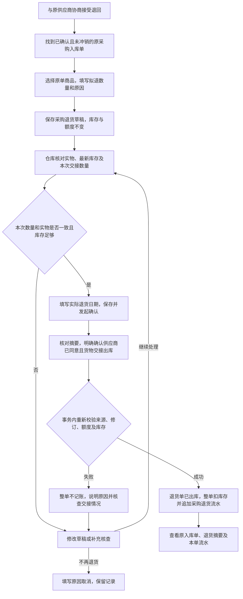

# 序仓 ERP：采购退货功能方案

版本：V1.0  
日期：2026-10-18  
状态：用户已确认并要求开发，已实现本地 MVP；验证入口见第 11 节  
关联：[ERP 产品 PRD](PRD-ERP产品.md)、[采购入库方案](PRD-ERP采购入库方案.md)、[销售退货方案](PRD-ERP销售退货方案.md)

## 1. 目标与现有基础

让经办人员按原采购入库记录登记向供应商退回的商品，在核对实物并交接出库时确认退货，扣减库存，保留来源明确的退货单和库存流水。

当前已实现采购入库、供应商及供货关联、采购录入纠错冲销、销售及销售退货、库存盘点。本方案新增实际采购退回业务，沿用本地单用户、单仓库、整数数量、整单确认和库存不预占的边界。真实目标企业、供应商接受退货的条件及现场交接方式仍待业务调研，本方案不自动判定供应商必须接受退货。

当前已在原工作区实现采购退货。产品为 4 个一级模块、11 个已实现页面；使用说明及验证入口已同步。

## 2. 范围与业务口径

| 本期纳入 | 后续扩展 |
| --- | --- |
| 一张退货单关联一张已确认且未冲销的采购入库单 | 无来源退货、跨入库单合并退货 |
| 按原单商品部分退货、分次退货 | 按采购订单退回、自动补货或换货 |
| 草稿、编辑、取消、交接时整单确认退货出库 | 独立退货申请、主管审批、物流及供应商签收跟踪 |
| 累计可退量、最新库存校验、重复及修订保护 | 库存预占、多仓库、批次、序列号、供应商库存分摊 |
| 退货流水、原单摘要、供应商及商品追溯 | 退款、应付冲减、税额、成本与利润核算 |
| 供应商／商品停用后的既有采购退回 | 坏品／待检／隔离库存管理、退货出库冲销及更正 |

采购入库记录实际收货；冲销入库纠正已经确认的录入错误，通过反向流水抵消原单库存影响；采购退货记录实际把商品退给原供应商。三种业务保留各自单据、类型及历史。

首版处理已计入当前统一账面库存、能够核对实物并已与供应商协商接受退回的商品。尚未入库的拒收商品不进入此流程，也不能扣减已有库存。多购退回、破损和规格不符等原因由经办人员如实填写；本期没有质量库存分类，需将问题实物另行妥善保管，不自动形成坏品隔离账或可售状态变化。

采购人员负责协商、找到原单并登记拟退明细；仓库人员负责核对、备货及交接出库。当前由同一“本地用户”兼任，不新增账号和权限。

## 3. 最小业务流程



| 步骤 | 用户操作 | 系统结果 |
| --- | --- | --- |
| 1 | 在采购入库详情点击“创建采购退货单”，或在采购退货列表新建并选原单 | 带入原入库单、实际供应商及原单商品 |
| 2 | 选择商品，填写拟退数量及逐行原因 | 展示原实收、累计已退、来源剩余可退额度、当前库存及当前最多可出库量 |
| 3 | 保存草稿，等待备货或完成协商 | 生成单号；库存和累计已退量不变 |
| 4 | 仓库核对实物，按本次准备交接的实际数量修正草稿 | 可以移除本次未交接的商品；不自动缩减填写的数量 |
| 5 | 填写实际退货日期并保存，点击“确认退货出库” | 显示原单、供应商、商品及本次扣减数量，要求最终复核 |
| 6 | 在货物实际交接出库时点击“确认交接并退货出库” | 重新校验并整单写入，成功后展示退货单和追溯入口 |

原计划退 10 件，本次只交接 6 件时，将本单改为 6 件，余下以后另建单。本期不跟踪退货申请欠交数，也不记录供应商最终签收或退款进度。“已出库”表示本方完成交接，不表示供应商已经签收或退款。

交接前先核对库存和实物。若最终校验失败，应暂停继续交接并核查已交接情况；系统失败提示只说明本次未记账，不能据此认定实物已归仓或另建一张单重复扣减。

## 4. 页面与查询

### 4.1 入口与详情

- 采购管理新增“采购退货”，与采购入库并列，现有导航同步增加为 11 个二级页面。
- 原采购入库详情仅对“已入库”记录提供创建入口；全部退完时禁用并说明原因，已冲销单不可作为来源。
- 从采购退货列表新建时，原单选择器支持入库单号、原送货单号和供应商搜索；只展示有来源剩余额度的已入库记录。当前库存为零的原单仍可选择并保存拟退草稿。
- 原单保存后固定。未保存时切换来源须确认清空明细；保存后选错来源应取消草稿并重建。
- 原入库详情展示“未退货／部分退货／全部退货”摘要及全部关联退货，包括草稿和已取消单；摘要只计已出库退货。原单仍为“已入库”，原数量、采购单价、金额及正数入库流水保留。
- 退货详情提供原入库单、供应商关联退货、逐商品库存及本单流水入口；流水单号优先返回采购退货详情。

### 4.2 列表与筛选

列表显示退货单号、原入库单号、供应商、商品种数、退货日期、状态、创建时间及操作。不同单位的数量不合计成一个退货总数量。

筛选包含关键词、状态、供应商、商品、创建日期起止及原入库单来源。关键词匹配退货单号、原入库单号、原送货单号、供应商名称快照、商品名称／编码和备注。多条件取交集，日期含起止当天，填反时提示并展示空结果；支持一键重置，来源条件有可清除标签。普通切页重置条件，跨页入口可携带来源。

供应商详情或列表增加“查看采购退货”入口，与既有“查看入库单”区分。商品库存查询可进入包含采购退货类型的流水。原入库单的流水查询可展示该来源的原入库、纠错冲销及采购退货，各条保持明确业务类型和各自单号。

### 4.3 表单与最终确认

新建、编辑和详情沿用现有采购、销售退货组件的布局。手机端逐项录入商品，正文及操作文字 14px、辅助信息最低 12px、输入文字 16px；表格仅在自身容器内滚动。

表单本次数量初始为空。录入期间库存不足时显示缺口，可以保存有效拟退草稿；确认按钮须提示库存不足，最终仍执行事务校验。未保存修改在关闭、切页和刷新前提醒，存储失败保留输入。

确认窗口逐项展示原实收、当前累计已退、剩余可退额度、当前库存及本次数量，并展示供应商和实际退货日期。每次打开重新勾选：“供应商已同意本次退货，我已核对上述实物与数量，并确认货物已交接出库。”系统记录的是经办人员声明，无法自动核实实物或供应商承诺。

## 5. 字段规则

| 字段 | 规则 |
| --- | --- |
| 采购退货单号 | 首次成功保存生成，建议 PR 前缀加日期和唯一序号，后续保持不变 |
| 原采购入库单 | 必选，状态必须为已入库；保存稳定 ID 及原单号，保存后固定 |
| 实际供应商 | 从原入库单带入稳定供应商 ID，优先沿用原单确认时名称快照，只读 |
| 原送货单号 | 从原入库单带入，只读参考，原单未填时允许为空 |
| 退货仓库 | 固定主仓库，只读 |
| 实际退货日期 | 草稿可空且初始为空；确认时必填有效日期，不晚于当天且不早于原单业务收货日期 |
| 商品 | 原入库单中的 1 至 100 种商品，同商品仅一行；不支持原单外商品 |
| 商品名称、编码、单位 | 优先使用原已入库单商品快照，只读；保存后不随基础资料改名而回写 |
| 原实收、累计已退、剩余额度 | 按原入库单及商品计算，只读 |
| 当前库存、当前最多可出库量 | 按最新账面库存计算，只读，明确尚未预占 |
| 本次退货数量 | 必填正整数，最大 1,000,000，且不超过来源剩余额度；确认时还须不超过最新库存 |
| 逐行退货原因 | 必填，去除首尾空格后 1 至 300 字，说明本次实际退回原因和交接差异 |
| 备注 | 选填，最多 1000 字 |
| 状态、修订号、创建／更新时间、确认时间及操作历史 | 系统记录，操作人为本地用户 |
| 取消原因 | 取消草稿时必填，去除首尾空格后 1 至 300 字，保留原明细及原因 |

不退的行从明细中移除，不填写 0。草稿可先登记拟退数量；确认前修改为本次实际交接量。非空日期保存时即校验，空日期只允许草稿。

日期表示业务交接日期；库存按最终确认时间生效，流水同时保留业务日期和实际记账时间，不回算历史库存。退货单不新增退款金额、付款状态或财务凭证，原采购价及金额可通过来源单查看。

旧原单缺少供应商或商品快照时，使用当前可用资料兼容补齐并保持稳定；这不构成对已经丢失的历史名称的恢复。实际供应商取自原单，不从商品当前默认供应商或供货关联推断。

## 6. 状态与数量校验

### 6.1 单据状态

| 当前状态 | 操作 | 目标／结果 | 库存及累计已退 |
| --- | --- | --- | --- |
| 未保存 | 保存有效明细 | 草稿 | 均不变 |
| 草稿 | 编辑保存 | 草稿，修订号增加 | 均不变 |
| 草稿 | 填写原因取消 | 已取消 | 均不变 |
| 草稿 | 确认交接出库成功 | 已出库 | 库存扣减，累计已退增加 |
| 草稿 | 任一校验或存储失败 | 保持原已保存状态 | 整单均不变 |
| 已出库 | 重复确认同一单 | 返回既有结果 | 不再次扣减或累计 |
| 已出库 | 查看 | 只读，历史保留 | 不变 |
| 已出库 | 编辑、取消或冲销 | 阻止，本期更正另行定义 | 不变 |
| 已取消 | 查看 | 只读 | 不变 |
| 已取消 | 编辑或确认 | 阻止 | 不变 |

取消只检查本单仍为草稿、修订号及取消原因；来源已冲销、额度不足或缺货的旧草稿仍能取消。

### 6.2 两项独立的数量约束

对原采购入库单 R 的商品 P：

```text
累计已退数量 = 所有关联 R 且已出库的采购退货单中 P 的数量之和
来源剩余可退额度 = R 中 P 的原实收数量 − 累计已退数量
当前最多可出库量 = min(来源剩余可退额度, 当前账面库存)
草稿保存：0 < 本次数量 ≤ 来源剩余可退额度
确认出库：0 < 本次数量 ≤ 最新来源剩余额度，且本次数量 ≤ 最新账面库存
确认后库存 = 最新账面库存 − 本次数量
```

草稿不预占原单额度或库存。多草稿可同时存在，最终分别读取最新事务状态。其他原单补货不会扩大本原单额度；销售或其他出库可能使库存减少，从而暂时阻止本次退货。系统不自动减少用户填写的数量。

例如原单实收 50 把，已退 10 把，来源剩余额度为 40 把；当前账面只剩 8 把时，本次 12 把可先存草稿，但确认出库被阻止。若核对后只交接 8 把，则修改为 8 把再确认。当前库存后来恢复为 100 把，也不能让这张原单累计退回超过 50 把。

库存目前按商品汇总。原入库关联提供业务依据，系统无法识别货架上的某件商品属于哪家供应商或哪一批；经办人员须核对实际货物与供应商认可的退回范围，不展示“某供应商剩余实物库存”之类的推断。

## 7. 与采购冲销的互斥规则

以下冲销互斥保护已同时在业务命令和界面中实现，确认按事务最新状态执行。

| 同一原入库单的情况 | 采购退货 | 整单冲销入库 |
| --- | --- | --- |
| 已入库，无已出库采购退货 | 可建草稿并按规则确认 | 沿用现有库存充足等纠错规则 |
| 只有退货草稿，尚未实际退货 | 可继续核对 | 允许冲销；成功后这些草稿失去有效来源，须取消或核查 |
| 已存在至少一张已出库采购退货 | 在原额度与库存范围内继续退 | 阻止，提示已有实际退货及关联单号 |
| 已冲销原单 | 不可新建或确认退货；已有草稿只能取消或查看 | 重试返回既有冲销结果 |
| 已冲销原单的已确认更正入库单 | 将更正单视为独立实际来源，可按其数量退货 | 更正单存在实际退货后同样阻止冲销 |

退货确认与原单冲销须在同一工作区事务机制中读取最新状态：冲销先成功则退货确认失败；退货先成功则冲销失败。不能在原单已经部分实际退回后，再按原全部实收数量冲销。已经完成的采购退货不通过取消草稿或新盘点恢复可退额度。

界面禁用提示与业务命令校验同时存在。仅隐藏冲销按钮不足以防止旧页面或其他入口误操作。

## 8. 停用、异常及重复处理

- 原单供应商或商品停用后，仍允许按历史来源登记和确认采购退货，状态保持停用；商品须存在且已初始化，供应商资料须存在。不新增供货关联，也不检查原供应商是否仍是当前默认或关联供货方。
- 任一商品来源不符、超额、确认缺货或日期无效，整单不出库。错误说明商品、来源剩余额度、当前余额及缺口。
- 草稿保存、确认和取消均检查修订号，旧页面不能覆盖或确认其他页面更新的明细，原输入保留供核对。取消与确认竞争时，只允许最先成功的一种结果。
- 同一退货单重复确认只扣库存一次；已出库重试先返回既有结果，再处理草稿状态和修订检查。
- 不同单号疑似重复：确认时检查同一原入库单、同一实际退货日期、相同商品及数量组合的已出库记录，忽略行顺序。展示已有单号，要求明确核对“这是另一次实际交接”后才允许继续，核对写入历史。
- 重复提醒排除草稿、取消单及本单；人工继续不越过数量、来源、修订或库存校验。其他日期或不同组合的重复登记仍须人工识别，该提醒不保证识别全部重复。
- 同一来源额度竞争、不同来源共用库存竞争均读取最新事务数据。单据、各商品库存及流水一起写入，任何失败整单回滚。
- 浏览器存储失败保留表单，提示先查询本单状态再重试同一单号。实物已经交接但记账失败时先核查库存业务及现场情况，不因页面报错就再退一批实物。
- 已出库后发现录错或供应商拒收，应保留单据和证据并核查实物。本期不提供自动撤销、直接修改原单或用盘点恢复采购额度的入口，后续业务更正另行设计。

## 9. 库存流水与盘点联动

确认采购退货时，每个商品追加一条“采购退货出库”负数流水，保留变动后余额、退货单号、原入库单关联、实际退货日期、实际记账时间及操作人；原采购正数入库流水保持原值。

原入库单明细和金额只读，退货摘要从已出库采购退货逐商品推导，不另建一份可编辑累计数。退货详情、原入库单、供应商、商品及流水可相互追溯。

新退货流水参与现有盘点基准：涉及商品的旧盘点草稿须重新核对实物；即使之后补货使账面数恢复，也不能沿用原清点结果。其他未涉及商品的盘点不受影响。采购退货及其他业务不预占库存，后续销售仍以最新库存进行出库判断。

## 10. 数据与实现衔接建议

本节说明本次模型、存储及界面的实现职责。

| 区域 | 实现职责 |
| --- | --- |
| `model.ts` | 增加 PurchaseReturn、PurchaseReturnInput、采购退货集合及保存／确认／取消命令、数量与摘要／查重辅助函数；在 reverse-receipt 加入实际退货保护 |
| `storage.ts` | 在原 IndexedDB 事务中兼容补齐 purchaseReturns 并持久保存，保留全部已有数据 |
| 采购退货工作区及编辑组件 | 原单搜索、固定供应商、逐项原因与数量、日期、草稿、交接勾选、重复提醒、取消及未保存保护 |
| `navigation.ts`、`ErpWorkspace.tsx` | 增加采购退货页面、原单及供应商入口、来源条件和流水优先跳转 |
| `PurchaseWorkspace.tsx` | 原入库单退货摘要／关联单据／创建入口，以及冲销互斥提示和禁用 |
| `filters.ts`、`ListFilters.tsx` | 采购退货组合筛选，流水采购退货类型和单据来源筛选 |
| `erp.module.css` | 复用现有样式并提供手机逐项明细 |

业务命令为 `save-purchase-return`、`confirm-purchase-return`、`cancel-purchase-return`。确认接收单据 ID、修订号和显式交接标记，疑似重复核对另传继续标记。来源、额度、库存、日期及停用历史规则在业务层统一检查。

PurchaseReturn 保存稳定 ID、单号、原入库 ID／单号、供应商 ID／名称快照、原送货单号、日期、备注、状态（draft／returned／cancelled）、修订号、商品快照／数量／原因、时间及历史。累计额度、库存和原单摘要实时推导，不由表单传入余额。

LedgerEntry 增加 `purchase-return` 类型及 `purchaseReturnId`，同时保留 `receiptId`；来源跳转优先退货单，原入库筛选仍能追溯相关变化。新集合进入 JSON 备份导出，同浏览器标签刷新沿用现有机制。

## 11. 验收清单

以下为交付验收条件。业务测试为 app/erp/purchase-returns.test.mjs，真实浏览器脚本为 app/erp/verify-purchase-returns.mjs；记录与截图位于 artifacts/erp/purchase-returns-*.log 和 artifacts/erp/purchase-return-*.png。

| 编号 | 场景 | 预期结果 |
| --- | --- | --- |
| P01 | 原库存 20，采购实收入库 50，创建退货 10 的草稿后确认 | 草稿时库存仍为 70；确认后为 60，累计已退 10、来源剩余额度 40，存在一条 −10 退货流水 |
| P02 | 同一原单再退 5，之后累计退完全部 50 | 分次按实际数量扣减；摘要依次部分退货、全部退货；原实收、采购价、金额及原流水保留 |
| P03 | 原单剩余额度 40，本次数量 41 | 保存或确认被阻止，不因其他原单补货扩大额度 |
| P04 | 原单额度足够，当前库存 8，本次退 12 | 可先保存草稿并提示缺口；最终确认整单阻止，不产生负库存 |
| P05 | 两个同源草稿各退 30，原实收 50 | 草稿均不占额度；首单确认后，次单按最新剩余 20 拦截 |
| P06 | 不同原入库单各有足够额度，共用同一商品库存 10，各退 8 | 只允许先成功的一单扣减，另一单提示缺货；两来源额度互不混用 |
| P07 | 多商品中任一行缺货、超额或来源无效 | 所有库存、单据状态和流水均保持原值，失败整单回滚 |
| P08 | 同单重复点击、刷新重试及并发确认 | 每行只一条采购退货流水，库存及累计只生效一次 |
| P09 | 草稿取消、旧页面保存／确认／取消及取消确认竞争 | 原因和历史保留；旧修订被阻止；取消与出库仅一种有效结果 |
| P10 | 已有已出库采购退货，当前库存又补足原实收数量，再冲销原单 | 冲销仍被阻止，展示实际退货关联；不能重复扣回原全部数量 |
| P11 | 只有退货草稿时原入库被冲销，或两者同时确认 | 冲销先成功则退货被阻止且草稿可取消；退货先成功则冲销被阻止 |
| P12 | 对已冲销原单、未确认入库单或原单外商品建退货 | 来源校验阻止；已确认更正入库单可独立作为来源 |
| P13 | 供应商／商品停用，供货关联取消或默认供应商改变 | 历史原单退回仍可处理，供应商固定，资料停用和供货关系保持原值 |
| P14 | 供应商／商品改名，旧记录缺快照 | 原快照优先，保存后不回写；缺失历史资料按兼容规则补齐并保持稳定 |
| P15 | 数量为空、零、负数、小数、超限、重复商品、原因空或超长 | 保存校验定位问题，1 至 100 行及字段长度边界正确 |
| P16 | 实际退货日期为空、未来、早于原业务收货日期或合法过去日期 | 草稿可空；确认必填；非法日期阻止；合法过去日期按当前确认时间记账 |
| P17 | 两张不同单据同原单、日期及双商品数量组合，明细顺序相反 | 识别疑似重复，须人工勾选；数量组合不同不误判；继续仍执行额度和库存校验 |
| P18 | 原单查关联退货、退货查流水、流水返回退货、供应商查退货 | 跳转与来源条件准确；草稿无成功出库流水；不同单位不混合汇总 |
| P19 | 状态／供应商／商品／日期／关键词组合及来源重置 | 条件取交集、日期含当天，反向日期提示空结果，重置与来源清除有效 |
| P20 | 已存盘点草稿后发生采购退货，再补货恢复原余额 | 原盘点仍须复核；其他未涉及商品盘点不受影响 |
| P21 | 存储写入失败、旧数据升级、刷新、标签同步及导出 | 失败整单回滚；新集合兼容补齐，既有数据保留；退货持久保存并进入备份 |
| P22 | 桌面与手机完整录入／交接确认、键盘操作及未保存离开 | 均可完成流程，字号、输入及操作完整，关闭切页刷新有提醒，确认须显式勾选 |

后续验证须包含纯业务测试、实际浏览器操作及真实 IndexedDB 并发／回滚；回归采购入库冲销、更正、销售出库、销售退货和盘点。代码规范、类型及构建检查按实际变更执行，浏览器使用独立测试配置。

## 12. 方案状态与后续

本地采购退货已按用户确认的方案实现，并同步主 PRD、采购入库方案、使用说明和实现说明。验证使用独立测试浏览器，保留用户日常业务数据；本轮没有提交或部署。退款、质量库存、供应商签收及退货出库更正后续扩展。

## 13. 文档变更

| 版本 | 日期 | 变更 |
| --- | --- | --- |
| V0.1 | 2026-10-18 | 首次整理采购退货：来源、交接出库、部分分次、双重数量校验、冲销互斥、停用历史、追溯、实现衔接及 22 项验收场景 |
| V1.0 | 2026-10-18 | 按用户确认实现本地采购退货及冲销互斥，同步页面、数据兼容、使用说明及业务／浏览器验收入口 |
