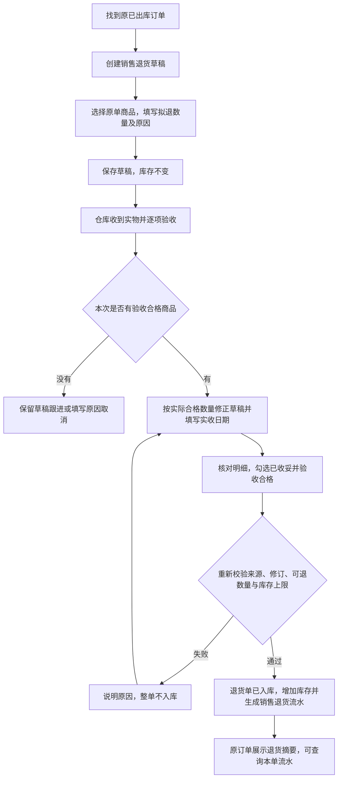

# 序仓 ERP：销售退货功能方案

版本：V1.0  
日期：2026-10-18  
状态：用户已确认并授权开发，已实现本地 MVP；验证入口见第 10 节  
关联：[ERP 产品 PRD](PRD-ERP产品.md)、[当前使用说明](app/erp/README.md)、[实现说明](app/erp/IMPLEMENTATION.md)

## 1. 目标与依据

用户能够从原已出库销售订单登记退货，在收到并验收合格后确认入库，看到库存增加，并从原订单、退货单和库存流水追溯本次业务。

本方案依据已有代码、项目文档及本轮用户确认的最小流程编写。当前版本采用本地单用户、单仓库、整数数量；销售订单一次整单出库，库存不预占。真实目标企业及现场操作习惯仍待调研，小型贸易／批发企业仅作讨论背景。

用户已同意的范围：关联原已出库订单，允许部分及分次退货，每张退货单一次确认，只接收验收合格且可重新销售的商品；保留原销售事实；退款、坏品、换货和审批后续扩展。

本方案补充页面、字段、异常、并发保护及验收标准。实现及验收按本方案执行。

## 2. 范围与操作分工

| 本期纳入 | 后续扩展 |
| --- | --- |
| 一张退货单关联一张已出库销售订单 | 无原单退货、跨订单合并退货 |
| 按原单选择部分商品及数量，允许多次退货 | 退货申请审批、物流及承运单跟踪 |
| 草稿、编辑、取消、验收后整单确认 | 分批确认同一张退货单 |
| 合格商品退回主仓库，增加账面库存 | 待检、残次品、隔离库存、维修、报废 |
| 累计可退数量、来源流水、历史记录及筛选 | 退款、应收调整、税额、成本与利润核算 |
| 原订单展示退货摘要和关联单据 | 换货、退货入库冲销及更正 |

销售人员负责找到原单、登记退货商品及原因、跟进结果。仓库人员负责实收核验、修正本次数量、确认入库。当前由同一“本地用户”操作，不增加员工账号或权限系统。

采用直接登记退货草稿、仓库验收后确认的路径，确认窗口承担最终核对。货未到、待核验等情况由草稿承接，本期不增加独立申请单、待审核或待入库状态。

## 3. 业务流程



| 步骤 | 用户操作 | 系统反馈 |
| --- | --- | --- |
| 1 | 从已出库订单创建退货，或从销售退货列表选择原订单 | 带入客户、原订单号、原出库单号及商品明细 |
| 2 | 勾选商品，填写拟退数量及逐行原因 | 展示原出库量、累计已退量和剩余可退量；本次数量初始为空 |
| 3 | 保存草稿 | 生成退货单号；库存和累计已退量均不变 |
| 4 | 收到实物，核对商品、数量及完好情况 | 未收妥或验收未完成时继续保留草稿 |
| 5 | 编辑为实际验收合格数量，填写实收日期并保存 | 保存最新修订，移除本次未收到或不合格的行 |
| 6 | 点击确认退货入库，核对摘要并勾选确认 | 明确本次入库商品及数量，提示入库成功后本单只读 |
| 7 | 点击“确认验收并入库” | 整单校验并保存，展示结果及原订单、库存、本单流水入口 |

一张退货单只记录本次确认的合格实收。原计划退 5 把、实际合格实收 3 把时，本单改为 3 把；余下商品以后到货并验收合格，再建新单。系统不另行跟踪本次退货申请的欠收数量。

混合收到合格品和坏品时，只将本次合格商品列入退货单；坏品需人工另行隔离和跟进，本期系统不记录其库存或处理进度。全部商品均不合格时不能确认空单。该边界须在录入及确认界面提示。

## 4. 页面与入口

### 4.1 导航与跨页入口

- 销售管理新增“销售退货”，成为第 10 个二级页面；原有页面保留。
- 已出库订单详情提供“创建退货单”，带入原单；所有商品均退完时禁用并说明原因。
- 销售退货列表提供“新建退货单”，先搜索并选择有剩余可退量的已出库订单。
- 原订单详情展示关联退货单，包含草稿和已取消记录，可进入详情。累计数量只统计已入库记录。
- 退货详情提供“查看原订单”“查看本单流水”；已入库明细提供对应商品的库存入口。
- 库存流水新增“销售退货入库”类型及退货单来源筛选，点击关联单号返回退货详情。

原订单的退货摘要与履约状态分别展示。原订单仍为“已出库”，摘要按原单逐商品数量推导为“未退货／部分退货／全部退货”；草稿及取消记录不改变摘要。原订单商品、成交单价、总金额、出库单号和原出库流水保持原值，现有订单金额统计仍按原口径计算。

### 4.2 列表

列表列：退货单号、原订单号、客户、商品种数、实收日期、状态、创建时间、操作。不将不同单位的数量合计成一个“退货总数量”。

筛选：关键词、状态、客户、商品、创建日期起止。关键词匹配退货单号、原订单号、原出库单号、客户名称快照、商品名称／编码及备注。日期含起止当天，按本地日期计算；开始晚于结束时提示错误并展示空结果。多条件取交集，支持一键重置。

由原订单打开退货列表时携带原订单条件并显示可清除的来源标签；普通切页按现有约定重置筛选。新建表单的原单选择器支持订单号、出库单号和客户搜索。

### 4.3 编辑、详情和确认

编辑页先选原单，再选商品。保存后原单固定，选错时取消草稿并重建；未保存时更换原单须确认清空原明细。

详情逐行展示原出库量、当前累计已退量、剩余可退量、本次数量、原因及历史商品资料。已入库单另展示确认时间及库存流水；动态可退量明确标为“当前累计”，避免与本单确认结果混淆。已入库单的本次数量、实收日期、原因及快照保持只读。

确认窗口展示客户、原订单号、实收日期、逐项商品及本次数量。复核勾选文案为“本单商品已收到并验收合格，可按本次数量入库”，按钮为“确认验收并入库”。每次打开窗口均重新勾选；确认代表本单全部商品已收妥。

关闭、切页或刷新有未保存修改的表单时给出提醒。确认只能使用已保存的草稿；成功写入后再展示成功结果。手机端明细按逐项表单排列，正文 14px、辅助信息最低 12px、输入文字 16px，沿用现有 ERP 字号基准。

## 5. 字段与录入规则

| 区域 | 字段 | 规则 |
| --- | --- | --- |
| 单头 | 退货单号 | 首次成功保存时生成，采用 SR 前缀及日期、序号，唯一且保持不变 |
| 单头 | 原销售订单 | 必选，状态为已出库；关联稳定订单 ID |
| 单头 | 原出库单号 | 从原订单带入，只读；缺少来源时阻止保存并提示核查 |
| 单头 | 客户 | 按原订单客户 ID 带入，只读，首次保存时记录当时客户名称快照 |
| 单头 | 实收日期 | 草稿可空、初始为空；确认时必填有效日期，允许当天或过去日期，禁止未来日期 |
| 单头 | 入库仓库 | 固定主仓库，只读 |
| 明细 | 商品 | 选择原订单中的商品，一单 1 至 100 行，同一商品一行 |
| 明细 | 名称、编码、单位 | 优先使用原销售订单商品快照，只读，后续资料修改不回写本单 |
| 明细 | 原出库量 | 当前整单一次出库，采用已出库订单对应商品的数量，只读 |
| 明细 | 累计已退量、剩余可退量 | 按原订单及商品实时计算，只读 |
| 明细 | 本次退货数量 | 必填正整数，最大 1,000,000，且不超过最新剩余可退量；确认前须改为实际验收合格数量 |
| 明细 | 退货原因 | 每行必填，去除首尾空格后 1 至 300 字；收货差异可在此或备注说明 |
| 其他 | 备注 | 选填，最多 1000 字 |
| 记录 | 状态、修订号、创建／更新时间、确认时间、操作人及操作记录 | 系统生成；操作人为本地用户 |
| 取消 | 取消原因 | 取消草稿时必填，去除首尾空格后 1 至 300 字，保留原明细和操作记录 |

不选择的商品从明细移除，不使用数量 0 表示不退。数量为空不能保存；草稿允许实收日期为空，因此可以在货物到达前登记拟退明细。

本期退货单处理商品数量，不录入退款金额、退款状态或财务凭证。原成交价格可通过原销售订单查询。

客户名称快照表示创建退货草稿时的资料，不能据此声称恢复了原销售发生时的客户名称。旧订单商品缺少快照时，按现有兼容方式使用当前可用资料补齐，之后保持稳定；不能从当前资料推断已经丢失的历史名称。

## 6. 状态及核心数量规则

### 6.1 状态

| 当前状态 | 操作 | 结果 | 库存及累计已退量 |
| --- | --- | --- | --- |
| 未保存 | 保存有效明细 | 草稿 | 不变 |
| 草稿 | 编辑并保存 | 草稿，修订号增加 | 不变 |
| 草稿 | 填写原因并取消 | 已取消 | 不变 |
| 草稿 | 验收后确认成功 | 已入库 | 按本次各行数量增加 |
| 草稿 | 校验失败或存储失败 | 保持原已保存状态 | 不变，整单失败 |
| 已入库 | 查询或重复确认同一单 | 保持已入库，返回原结果 | 不重复增加 |
| 已入库 | 编辑、取消或冲销 | 阻止，提示本期边界 | 不变 |
| 已取消 | 查询 | 保持已取消 | 不变 |
| 已取消 | 编辑或确认 | 阻止 | 不变 |

取消动作只检查单据仍为草稿、修订号和取消原因；可退量已不足的旧草稿仍可取消。

### 6.2 可退量

对原订单 O 的商品 P：

```text
累计已退量 = 所有关联 O 且状态为已入库的退货单中 P 的本次数量之和
剩余可退量 = O 中 P 的原实际出库数量 − 累计已退量
允许确认：0 < 本次退货数量 ≤ 最新剩余可退量
确认后账面库存 = 确认事务中的最新账面库存 + 本次退货数量
```

剩余可退量与当前仓库余额独立。商品后来再次销售、采购或盘点，不会改变本笔原销售的可退量。

草稿不预占额度，同一原订单允许多个草稿。保存和确认均重新校验：例如原出库 10 件，两个草稿各退 6 件；任一先确认后，另一个确认被阻止并提示最新剩余可退 4 件，须人工修改并重新核对。系统不自动缩减拟入库数量。

相关其他退货确认后，若本单仍在最新可退范围内，可继续确认；单纯发生其他进出库也不要求重新录入退货数量，确认时使用最新余额并检查增加后不超过 1,000,000。

### 6.3 原单、停用及历史

仅已出库订单可退，原商品及来源须存在。确认时再次检查原单状态、原出库单号与保存的来源一致，不能使用草稿、待出库或已取消订单。

已停用但已初始化的原单商品允许退回，界面显示停用状态并保持停用。停用不代表实物损坏，仍须人工验收；退回后新开单的停用保护沿用原规则。缺失商品或未初始化等异常数据整单阻止，不自动新建商品或初始化库存。

已确认退货单不直接编辑或冲销。发现录入错误时保留单据，核对实物和关联流水并记录问题，后续更正能力另行设计。界面不提供使用盘点代替销售退货单据更正的捷径。

## 7. 异常、重复与并发保护

| 情况 | 系统行为及用户处理 |
| --- | --- |
| 未收到货、验收未完成 | 保留草稿，最终操作须明确勾选实收与验收；系统无法自动核实实物 |
| 实收少于拟退量 | 用户修改为本次合格实收数并保存；余下以后另建单 |
| 来货含非原单商品 | 阻止添加，先核查原单及实际货物来源 |
| 任一商品超退、数量无效或增加后超库存上限 | 定位商品、说明原因，整单不生效 |
| 同单重复点击、刷新后重试、两标签同时确认 | 仅第一次增加库存；后续返回原入库结果 |
| 同一草稿被其他页面编辑 | 保存、确认、取消均检查修订号；旧页面提示重新打开核对，保留用户未保存内容供查看 |
| 取消与确认同时发生 | 以事务先成功者为准；取消成功不能入库，入库成功不能取消 |
| 不同退货单争用可退额度 | 每次读取最新已入库退货，后执行者按剩余额度校验 |
| 不同退货单可能登记同一次收货 | 确认时检查相同原单、相同实收日期、相同商品及数量组合的已入库单；展示已有记录，明确核对后才允许继续 |
| 本地存储失败 | 单据、库存及流水一起回滚，保留表单，提示重试同一单据 |
| 操作结果不明确 | 先重新查询本单状态及流水，再重试同一单号；避免另开新单 |

疑似重复检查忽略明细排列顺序，排除本单、草稿及取消单。提醒文案说明：同日同量也可能是独立收货，用户需核对已有单号。用户明确继续时仅越过疑似重复提醒，原单、修订、数量及库存校验始终执行；这次人工核对写入操作记录。

可退数量能防止累计退超，无法识别所有重复登记。上述提醒只能识别相同日期与明细组合，其他重复仍需经办人员核实实物与单号；该限制在使用说明中明确。

## 8. 库存、流水与盘点联动

每张退货单确认时，对每行商品追加一条“销售退货入库”正数流水，保留实际记账时间、实收日期、变动数量、变动后余额、退货单号、原订单关联及操作人。原销售出库负数流水保持原值。

退货单、各商品库存及流水在同一读写事务中整单写入。累计可退量在同一事务内根据最新已入库退货计算，不采信页面传来的累计值。原订单退货摘要由单据推导，避免额外维护一份累计数量。

流水记账时间为确认时间；过去实收日期只作业务记录，不回算历史库存。流水日期筛选沿用实际记账日期，退货列表按创建日期筛选，两处均明确字段含义。

退货入库会新增相关商品的库存流水，现有盘点基准检查应据此阻止旧盘点确认，提示重新清点；即使后续出库使余额恢复原值，仍需重新核对。其他未涉及商品的盘点保持原规则。

## 9. 现有实现的衔接

本节记录本次数据与界面职责，具体实现以源码为准。

### 9.1 数据与业务命令

- 工作区增加 `salesReturns` 集合，旧工作区缺失时补齐为空并持久保存；保留现有商品、客户、订单、采购、盘点、流水及序号，不重置数据库。
- 退货单保存稳定 ID、编号、原订单 ID、原出库单号、客户 ID 与名称快照、实收日期、状态、修订号、备注、明细、时间及操作历史。明细保存商品 ID、名称／编码／单位快照、本次数量及原因。
- 原出库量、当前累计已退量、剩余可退量及原订单摘要从已有数据计算，不作为可由表单覆盖的余额字段。
- `model.ts` 新增保存、确认、取消退货的业务命令。确认接收单据 ID、修订号及显式验收标记；疑似重复经核对后可携带继续标记。已入库同单重试先返回既有结果，草稿操作再校验修订号。
- `LedgerEntry` 增加 `sale-return` 类型及 `salesReturnId` 来源关联，同时保留 `orderId`。流水跳转优先按退货单 ID 打开退货详情。
- `storage.ts` 沿用现有 IndexedDB 事务；旧数据补齐包含新集合。所有业务校验在事务读取到的最新工作区执行。

### 9.2 界面职责与兼容

| 文件／区域 | 实现职责 |
| --- | --- |
| `navigation.ts`、`ErpNavigation.tsx` | 增加销售退货页面，沿用模块折叠及面包屑 |
| `ErpWorkspace.tsx` | 增加页面调度、订单创建退货入口及摘要、流水跳转与跨页条件 |
| 新增销售退货工作区组件 | 列表、详情、确认、取消、筛选和跨页入口 |
| 新增销售退货编辑组件 | 原单选择、退货商品及数量、实收日期、原因、未保存保护及手机逐项录入 |
| `filters.ts`、`ListFilters.tsx` | 退货列表组合筛选，流水退货类型及来源筛选 |
| `model.ts`、`storage.ts` | 单据、最新可退量、修订、重复保护及兼容补齐 |
| `erp.module.css` | 复用现有表格、状态、表单和响应式样式 |

新集合纳入 JSON 备份导出。同浏览器多标签通过已有广播及窗口激活机制刷新，最终操作仍以事务校验为准。单据引用参与商品“已有业务”判断；历史快照和商品编码／单位锁定沿用现有规则。

主 PRD 已同步功能、流程、模块数量、流水类型、验收与版本记录，README 和 IMPLEMENTATION 已补充操作及验证入口。后续变更继续以代码和相应验收为依据更新文档。

## 10. 验收标准

以下为销售退货验收条件。业务、类型、规范及真实浏览器验证入口见 app/erp/README.md；本次运行记录位于 artifacts/erp/returns-*.log，截图位于 artifacts/erp/sales-return-*.png。

| 编号 | 场景 | 预期结果 |
| --- | --- | --- |
| R01 | 原库存 100 把，销售出库 30 把后退回 5 把 | 保存退货草稿库存仍为 70；确认后为 75，累计已退 5、剩余可退 25，生成一条 +5 流水 |
| R02 | 同一订单再退回 3 把 | 库存变为 78，累计已退 8、剩余可退 22，两张退货单均可追溯 |
| R03 | 剩余可退 22，把本次数量填为 23 | 保存或确认被阻止，库存、单据及流水无部分成功 |
| R04 | 对已入库退货反复点击、刷新重试、两标签确认 | 仅增加一次库存，每行仅一条退货流水 |
| R05 | 草稿编辑、填写原因取消、取消后再确认 | 编辑和取消无库存变化；取消原因保留；取消单不可确认 |
| R06 | 使用未出库订单或非原单商品 | 保存及确认的业务规则均阻止越界来源 |
| R07 | 同一原单的两个草稿各退 6，原出库 10 | 两草稿可保存；首单入库后，次单超退被阻止并提示只剩 4 |
| R08 | 多商品退货，其中一行超退或库存增加后超限 | 所有商品及流水均不生效，单据保留草稿 |
| R09 | 草稿未收货，日期为空；实收数量少于拟退数量 | 草稿可保存；缺少实收日期或验收勾选不能确认；改为实际合格数量后可确认 |
| R10 | 实收日期填过去或未来日期 | 过去日期可记入业务日期；未来或无效日期被阻止；余额按确认时点生效 |
| R11 | 商品停用、改名或客户改名 | 停用原单商品可退且保持停用；历史商品及已保存客户快照不被新资料覆盖 |
| R12 | 旧页面编辑、确认或取消已被更新的草稿 | 修订号不符时阻止；不能覆盖或确认其他页面的新明细 |
| R13 | 取消与确认并发，或存储写入失败 | 只允许一种有效结果；失败整单回滚，不出现状态与库存矛盾 |
| R14 | 相同原单、日期及商品数量组合另建一张退货 | 提示已有入库单；人工继续后仍执行可退量等全部检查并记录核对 |
| R15 | 退回部分商品，再把原单剩余全部退完 | 摘要依次为部分退货、全部退货；原已出库状态、数量、成交价、金额和原出库流水保留 |
| R16 | 从订单、退货、流水之间跳转，组合筛选并重置 | 来源和筛选准确；草稿没有退货入库流水；不同单位不混合汇总 |
| R17 | 保存盘点草稿后，该商品发生退货入库 | 旧盘点被阻止；退货后再出库使净变化为零也需重盘；其他商品盘点不受影响 |
| R18 | 旧工作区升级、刷新、导出及同浏览器标签同步 | 新集合兼容补齐，既有数据保持，退货数据持久保存并进入备份 |
| R19 | 数量空、零、负数、小数、超限，重复商品或原因空 | 定位问题且整单不保存；1 至 100 行及字段长度边界正确 |
| R20 | 桌面与手机操作及未保存离开 | 均能建单、验收、取消及追溯；输入和操作完整，离开有提醒 |

验证应包括纯业务行为、组合筛选及真实浏览器 IndexedDB 事务；异常用例核查原状态保持，不能仅判断提示文案。回归已有销售、采购、供货关联及盘点流程，类型检查及相关代码规范检查通过。浏览器验收沿用独立测试配置，不改用户日常工作区数据。

## 11. 交付边界

用户已确认本方案并要求直接开发。本次在原工作区实现本地可操作版本，主 PRD、使用说明和实现说明同步更新。验证采用独立测试浏览器，保留用户日常工作区；本次未提交或部署。

平台自动同步、退款、坏品库存、换货、审批及退货入库冲销更正后续扩展。当前单据由经办人员关联原 ERP 销售订单创建；接入电商平台后，可增加平台售后同步来源，共用后续验收与入库规则。

## 12. 文档变更

| 版本 | 日期 | 变更 |
| --- | --- | --- |
| V0.1 | 2026-10-17 | 将已同意的最小销售退货流程展开为页面、字段、状态、累计可退量、实收验收、并发、盘点联动、数据衔接及验收方案 |

| V1.0 | 2026-10-18 | 用户确认后实现本地销售退货；同步入口、业务规则、兼容、操作说明及验证入口 |
